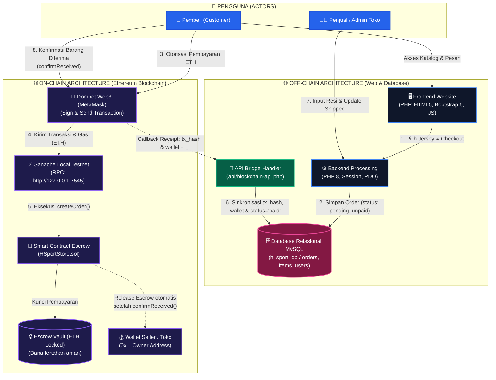

# H-Sport Financial dApp ⚽💎
### E-Commerce Jersey Olahraga Terdesentralisasi Berbasis Ethereum Smart Contract & Parallel Computing

[](https://soliditylang.org/)
[](https://www.php.net/)
[](https://www.mysql.com/)
[](https://trufflesuite.com/)
[](https://metamask.io/)
[](LICENSE)

---

## 📌 1. Ringkasan Proyek (Overview)

**H-Sport Financial dApp** adalah platform *e-commerce* kustomisasi jersey olahraga yang menggabungkan backend web modern dengan teknologi **Distributed Ledger Technology (Ethereum Blockchain / Smart Contract)** untuk menghadirkan transaksi keuangan yang aman, transparan, dan terdesentralisasi.

### Masalah yang Diselesaikan:
1. **Risiko Penipuan Penjual/Pembeli (Zero Trust Transaction):** Uang pembayaran pembeli tidak langsung ditransfer ke penjual, melainkan dikunci di dalam **Smart Contract Escrow**. Dana baru dilepaskan otomatis ke penjual setelah pembeli menerima barang fisik dan melakukan konfirmasi penerimaan.
2. **Integritas Data Transaksi (Tamper-Proof Audit Trail):** Bukti pembayaran (*tx hash*, alamat dompet, *block number*) tersimpan permanen di blockchain dan disinkronkan ke database relasional.
3. **Penyimpanan Terdistribusi (On-Chain vs Off-Chain Hybrid):**
   - **On-Chain:** Logika finansial escrow, penguncian saldo ETH, *state machine* order, emisi event audit.
   - **Off-Chain:** Katalog jersey, visual custom jersey, data profil pengguna, alamat pengiriman fisik, keranjang belanja, dan ulasan.

---

## 🏗️ 2. Arsitektur Sistem



### Siklus Status Pesanan (State Machine):
1. **`Created / Pending`** ➔ Pesanan dibuat di sistem toko.
2. **`Paid`** ➔ Pembeli mentransfer ETH ke Smart Contract melalui MetaMask (`createOrder`). Dana ditahan di escrow.
3. **`Shipped / Production`** ➔ Penjual memproses pesanan dan menandai status pengiriman (`shipOrder`).
4. **`Completed`** ➔ Pembeli mengonfirmasi barang telah diterima (`confirmReceived`). Smart contract secara otomatis mencairkan dana escrow ke alamat dompet penjual/pemilik kontrak.

---

## 🛠️ 3. Spesifikasi Teknologi (Tech Stack)

| Kategori | Teknologi / Alat | Versi / Keterangan |
|---|---|---|
| **Web Server** | Apache (Laragon / XAMPP) | PHP 8.0+ / 8.2 |
| **Database** | MySQL / MariaDB | Database: `h_sport_db` |
| **Smart Contract** | Solidity | `^0.8.19` (`HSportStore.sol`) |
| **Blockchain Framework** | Truffle Suite & Hardhat | Truffle `^5.11.5`, Web3 `^4.16.0` |
| **Local Testnet** | Truffle Ganache (GUI / CLI) | Port: `7545`, Network/Chain ID: `1337` / `5777` |
| **Web3 Client** | MetaMask Chrome Extension & Web3.js | Library Browser Web3 |
| **Frontend UI** | HTML5, CSS3, JavaScript, Bootstrap 5 | FontAwesome, Plus Jakarta Sans |

---

## 📂 4. Struktur Folder Proyek

```
project_jersey/
├── admin/                     # Dashboard & Manajemen Backoffice Admin
│   ├── customers.php          # Manajemen data pelanggan
│   ├── dashboard.php          # Dashboard analitik & ringkasan penjualan
│   ├── order-detail.php       # Detail pesanan admin & update resi/blockchain receipt
│   ├── orders.php             # Daftar semua pesanan
│   ├── payments.php           # Verifikasi pembayaran manual/QRIS
│   ├── products.php           # CRUD produk jersey olahraga
│   ├── reports.php            # Laporan penjualan & ekspor data
│   └── reviews.php            # Moderasi & balasan ulasan pelanggan
├── api/                       # API Endpoint Asinkron
│   └── blockchain-api.php     # Endpoint sinkronisasi tx_hash & wallet address ke MySQL
├── blockchain/                # Modul Smart Contract & Development Blockchain
│   ├── build/contracts/       # Hasil kompilasi ABI JSON kontrak
│   ├── config/                # Output otomatis contract address & ABI
│   │   ├── contract_abi.json
│   │   └── contract_address.txt
│   ├── contracts/             # Berkas Smart Contract Solidity
│   │   └── HSportStore.sol    # Smart Contract Escrow utama
│   ├── migrations/            # Skrip deploy / migrasi Truffle
│   │   └── 1_deploy_hsportstore.js
│   ├── scripts/               # Helper script (cek koneksi Ganache)
│   │   └── checkGanache.js
│   ├── package.json           # Dependensi Node.js modul blockchain
│   └── truffle-config.js      # Konfigurasi network Ganache & compiler
├── config/                    # Konfigurasi Backend
│   ├── database.php           # Koneksi PDO MySQL & session start
│   └── functions.php          # Helper functions (auth, sanitasi, order ID)
├── docs/                      # Dokumentasi Proyek
│   └── DOKUMENTASI_PROJECT_DAN_PERAN.md # Dokumen rincian peran 9 anggota tim & test matrix
├── img/                       # Aset gambar statis, banner & logo
├── includes/                  # Komponen UI Reusable
│   ├── navbar.php             # Navigasi utama & keranjang belanja
│   └── footer.php             # Footer & informasi toko
├── uploads/                   # Direktori berkas dinamis (desain custom, bukti bayar)
├── add-to-cart.php            # Endpoint penambahan produk ke keranjang
├── cart.php                   # Halaman keranjang belanja
├── checkout.php               # Halaman checkout & penentuan alamat kirim
├── crypto-payment.php         # Halaman pembayaran Web3 ETH via MetaMask
├── customize.php              # Halaman interaktif kustomisasi desain jersey
├── generate-qr.php            # Halaman pembayaran QRIS
├── h_sport_db (1).sql         # SQL dump skema database & data awal
├── index.php                  # Halaman beranda (Home)
├── login.php                  # Halaman autentikasi login pengguna & admin
├── logout.php                 # Proses logout
├── migration_reviews.sql      # Migrasi tabel ulasan produk (reviews)
├── order-detail.php           # Halaman detail pesanan pelanggan & receipt blockchain
├── orders.php                 # Daftar pesanan pelanggan & tombol konfirmasi terima
├── product-detail.php         # Detail spesifikasi jersey & pemilihan ukuran
├── products.php               # Katalog jersey & filter kategori
├── register.php               # Halaman registrasi akun baru
├── review.php                 # Form ulasan dan rating produk
├── update-cart.php            # Update kuantitas / item di keranjang
└── upload-payment-proof.php   # Upload bukti transfer pembayaran manual
```

---

## 🚀 5. Panduan Instalasi & Menjalankan Proyek (Step-by-Step)

Ikuti panduan berikut langkah demi langkah untuk menjalankan proyek dari awal pada komputer lokal:

### Langkah 1: Prasyarat Software
Pastikan software berikut telah terpasang di komputer Anda:
1. **Laragon** (atau **XAMPP**) dengan PHP 8.0+ dan MySQL.
2. **Node.js** (versi 18+ LTS) & **npm**.
3. **Ganache** ([Download Ganache GUI](https://trufflesuite.com/ganache/)).
4. **Google Chrome** dengan ekstensi **MetaMask** ([metamask.io](https://metamask.io/)).

---

### Langkah 2: Setup Database MySQL
1. Jalankan **Apache** dan **MySQL** di Laragon/XAMPP.
2. Buka **phpMyAdmin** melalui browser (`http://localhost/phpmyadmin`).
3. Buat database baru bernama: `h_sport_db`.
4. Import file SQL utama:
   - Pilih database `h_sport_db` ➔ klik tab **Import**.
   - Unggah berkas `h_sport_db (1).sql` ➔ klik **Import**.
5. Jalankan migrasi tabel review:
   - Klik tab **Import** atau tab **SQL**.
   - Eksekusi berkas `migration_reviews.sql`.
6. Pastikan konfigurasi koneksi di file [config/database.php](config/database.php) sudah sesuai dengan kredensial database lokal Anda:
   ```php
   $host = 'localhost';
   $dbname = 'h_sport_db';
   $username = 'root';
   $password = ''; // Kosongkan jika default Laragon/XAMPP
   ```

---

### Langkah 3: Setup Blockchain Lokal (Ganache)
1. Buka aplikasi **Ganache**.
2. Klik tombol **QUICKSTART (Ethereum)**.
3. Pastikan konfigurasi RPC server Ganache sesuai:
   - **RPC Server:** `HTTP://127.0.0.1:7545`
   - **Network ID:** `5777` (atau `*`)
4. Biarkan aplikasi Ganache tetap terbuka dan berjalan di latar belakang.

---

### Langkah 4: Compile & Deploy Smart Contract (Truffle)
1. Buka terminal / Command Prompt / PowerShell, lalu masuk ke folder blockchain:
   ```bash
   cd c:\laragon\www\project_jersey\blockchain
   ```
2. Pasang dependensi Node.js:
   ```bash
   npm install
   ```
3. Uji koneksi ke Ganache:
   ```bash
   npm run ganache:ping
   ```
   *Jika sukses, akan muncul pesan `Ganache connected: http://127.0.0.1:7545` beserta daftar akun uji coba.*

4. Lakukan kompilasi dan migrasi Smart Contract ke Ganache:
   ```bash
   npm run compile
   npm run migrate
   ```
   *(Atau jalankan: `npx truffle migrate --network ganache --reset`)*

5. **Verifikasi:**
   Periksa folder `blockchain/config/`. Pastikan dua berkas berikut telah otomatis terbuat dan terisi:
   - `blockchain/config/contract_address.txt` (berisi alamat kontrak yang baru dideploy).
   - `blockchain/config/contract_abi.json` (berisi ABI kontrak).

---

### Langkah 5: Konfigurasi MetaMask
1. Buka browser Chrome, buka ekstensi **MetaMask**.
2. **Tambahkan Jaringan Ganache secara manual:**
   - Klik pemilih jaringan di kiri atas MetaMask ➔ **Add network** ➔ **Add a network manually**.
   - Masukkan informasi berikut:
     - **Network name:** `Ganache Local`
     - **New RPC URL:** `http://127.0.0.1:7545`
     - **Chain ID:** `1337` (atau `5777` jika Ganache Anda menggunakan 5777)
     - **Currency symbol:** `ETH`
   - Klik **Save** dan beralih (*Switch*) ke jaringan `Ganache Local`.
3. **Import Akun dari Ganache ke MetaMask:**
   - Di aplikasi Ganache, klik ikon kunci 🔑 pada **Account 0** (atau Account 1).
   - Salin **Private Key**.
   - Di MetaMask, klik ikon profil/avatar ➔ **Import account** ➔ tempelkan Private Key ➔ klik **Import**.
   - Saldo akun akan otomatis menampilkan **100 ETH** (uang uji coba Ganache).

---

### Langkah 6: Menjalankan & Mengakses Website
1. Buka browser dan kunjungi:
   - **URL Toko (Frontend):** `http://localhost/project_jersey` (atau `http://project_jersey.test` jika menggunakan virtual host Laragon).
   - **URL Panel Admin:** `http://localhost/project_jersey/admin/dashboard.php`.

2. **Kredensial Akun Bawaan (Default Login):**
   - **Akun Administrator:**
     - Email: `admin@hsport.com`
     - Password: `admin123`
     - Hak Akses: Manajemen produk, status pengiriman, verifikasi pembayaran, nomor resi, laporan.
   - **Akun Pelanggan (Customer):**
     - Email: `customer@example.com`
     - Password: `password`
     *(Atau buat akun baru melalui menu [register.php](register.php))*

---

## 🛒 6. Panduan Pengujian Alur Transaksi Crypto Escrow (End-to-End)

Untuk mendemonstrasikan sistem pembayaran terdesentralisasi:

1. **Login sebagai Pelanggan:**
   - Masuk ke `login.php` dengan akun pelanggan.
2. **Pilih Jersey & Tambahkan ke Keranjang:**
   - Buka menu `products.php`, pilih produk, tentukan ukuran (S, M, L, XL), warna, atau kustomisasi nomor punggung.
   - Klik **Beli Sekarang** atau **Tambah ke Keranjang**.
3. **Checkout:**
   - Masuk ke `cart.php` ➔ Klik **Checkout**.
   - Masukkan alamat pengiriman dan pilih ekspedisi kurir.
   - Pilih metode pembayaran atau klik Lanjutkan.
4. **Bayar dengan Cryptocurrency (ETH):**
   - Pada daftar pesanan (`orders.php`) atau detail pesanan (`order-detail.php`), klik tombol **Bayar Crypto**.
   - Anda akan diarahkan ke halaman modern **`crypto-payment.php`**.
   - Klik **Hubungkan Dompet (Connect MetaMask)**.
   - Periksa rincian tagihan (nilai IDR dikonversi ke ETH, misal Rp 150.000 ≈ 0.0150 ETH).
   - Klik **Konfirmasi Pembayaran ETH**.
   - MetaMask akan muncul meminta tanda tangan transaksi. Klik **Confirm**.
   - Smart Contract menjalankan `createOrder()`, mengunci dana di escrow, dan API backend `api/blockchain-api.php` mencatat `tx_hash` serta `wallet_address` ke database.
5. **Admin Memproses & Mengirim Pesanan:**
   - Buka tab lain atau browser terpisah, login sebagai Admin (`admin@hsport.com`).
   - Masuk ke `admin/orders.php` ➔ Buka pesanan yang bersangkutan.
   - Ubah status pesanan menjadi **Dikirim (Shipped)**, masukkan nomor resi (contoh: `JNE987654321`), lalu klik **Simpan Perubahan**.
6. **Pelanggan Menerima Barang & Melepaskan Dana Escrow:**
   - Kembali ke akun Pelanggan di `orders.php`.
   - Pesanan kini berstatus **Sedang Dikirim**.
   - Klik tombol hijau **Konfirmasi Barang Telah Diterima**.
   - Sistem Web3 akan memanggil fungsi `confirmReceived()` pada Smart Contract.
   - Konfirmasi transaksi di MetaMask.
   - Dana escrow (ETH) secara otomatis berpindah ke alamat dompet penjual/pemilik toko (`owner`).
   - Status pesanan berubah menjadi **Selesai (Completed)** dengan efek selebrasi konfeti!

---

## 🔐 7. Matriks Pengujian & UAT (21 Test Cases)

Proyek ini telah dirancang untuk memenuhi standar 21 kasus uji terstruktur:

| Kategori | Kode | Deskripsi Pengujian |
|---|---|---|
| **Smart Contract** | **SC-01 s.d SC-06** | Inisialisasi kontrak, kepemilikan (`owner`), pembuatan order dengan ETH valid, proteksi nilai 0, pembacaan order info, dan modifier hak akses (`onlyOwner`, `onlyBuyer`). |
| **Smart Contract** | **SC-07 s.d SC-12** | Validasi pengiriman (`shipOrder`), larangan kirim jika belum bayar, konfirmasi penerimaan (`confirmReceived`), pencairan escrow otomatis, proteksi double release, emisi events, dan revert unauthorized access. |
| **Integrasi** | **INT-01 s.d INT-05** | Konektivitas RPC node, sinkronisasi order DB lokal ke Smart Contract, pembacaan receipt & tx hash, persistensi data blockchain ke MySQL, validasi konsistensi on-chain vs off-chain. |
| **Parallel Computing**| **PAR-01 s.d PAR-04** | Eksekusi verifikasi sekuensial baseline vs multi-worker paralel, pengukuran speedup & throughput (TPS), serta ketahanan konkurensi (mencegah race condition). |

---

## ❓ 8. FAQ & Solusi Kendala (Troubleshooting)

### Q1: MetaMask memunculkan error *"Nonce too high"* atau *"RPC Error"*?
> **Solusi:** Hal ini terjadi jika Ganache di-restart sementara MetaMask masih menyimpan histori transaksi sebelumnya.  
> Buka MetaMask ➔ Klik ikon Profil ➔ **Settings** ➔ **Advanced** ➔ Klik **Clear activity tab data** (atau **Reset account**). Saldo Anda tidak akan hilang, hanya riwayat nonce yang disinkronkan ulang.

### Q2: Error *"Contract not found"* atau *"Failed to fetch contract address"*?
> **Solusi:** Pastikan Anda telah menjalankan `npm run migrate` di dalam folder `blockchain/` dan Ganache tetap aktif di port 7545. Pastikan berkas `blockchain/config/contract_address.txt` sudah ada dan memiliki format alamat Ethereum valid (42 karakter diawali `0x`).

### Q3: Tidak bisa konek ke MySQL *"Connection failed: Access denied..."*?
> **Solusi:** Periksa berkas `config/database.php`. Jika MySQL Anda menggunakan password, sesuaikan variabel `$password = 'password_anda';`. Pastikan nama database adalah `h_sport_db`.

### Q4: Ganache GUI port bentrok atau beda port?
> **Solusi:** Ganache GUI default di port `7545`. Jika Ganache Anda berjalan di port `8545`, sesuaikan port di `blockchain/truffle-config.js` dan setting RPC MetaMask.

---

## 👥 9. Tim Pengembang & Kontribusi

Proyek ini dikembangkan oleh 9 anggota tim dengan pembagian tanggung jawab terstruktur:
1. **Muhammad Feeandri Syahbani** — *Requirement, Scope & Technical Documentation Lead*
2. **Yasmin Akmaliyah** — *Business Process & Acceptance Analyst*
3. **Arby Putra** — *Solidity Developer I (Order Core Architecture)*
4. **Agustina Elsi Bunga** — *Solidity Developer II (Payment, Escrow & State Logic)*
5. **Muhammad Farrel** — *Blockchain Infrastructure & Deployment Engineer*
6. **Luis** — *PHP/Laravel-Blockchain Integration Engineer*
7. **Ihsanul Farrel** — *dApp UI/UX & Proof Visualization Designer*
8. **Farelly De Rossi** — *Database & Parallel Processing Engineer*
9. **Kenjiro B.H.G** — *QA, Security & Performance Benchmark Engineer*

Rincian lengkap matriks deliverable setiap peran dapat dilihat pada dokumen:  
📄 **[DOKUMENTASI_PROJECT_DAN_PERAN.md](docs/DOKUMENTASI_PROJECT_DAN_PERAN.md)**

---

## 📄 10. Lisensi
Hak Cipta © 2026 **H-Sport Jersey Team**. Dirilis di bawah lisensi [MIT License](LICENSE).
