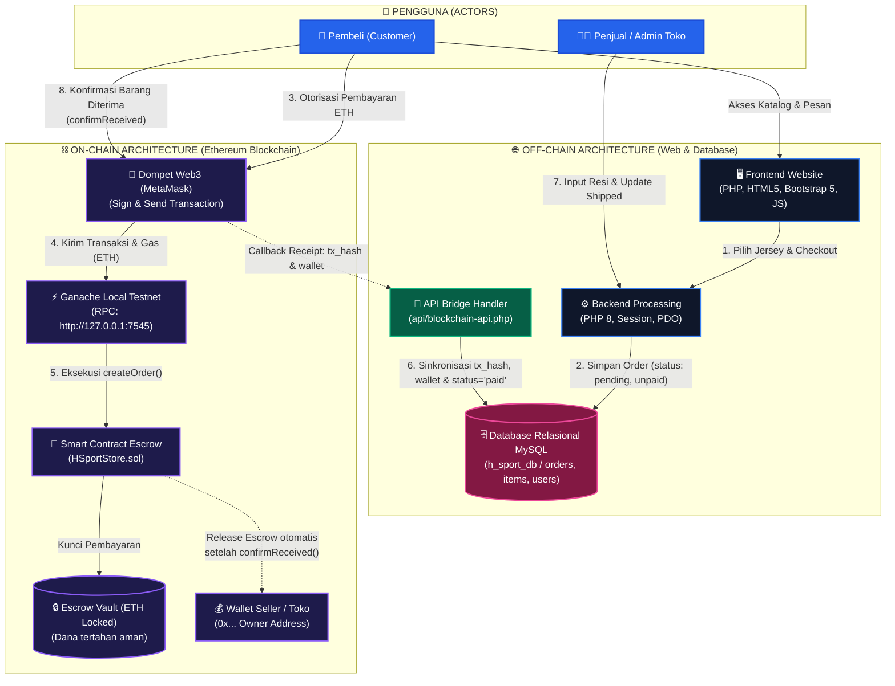
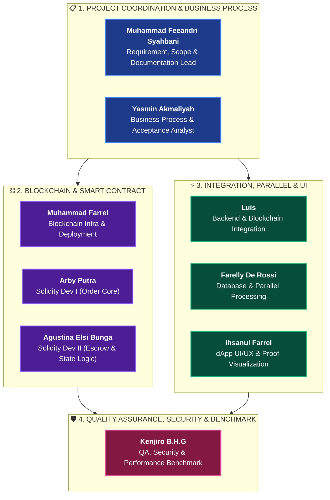

# H-Sport Financial dApp ⚽💎
### E-Commerce Jersey Olahraga Terdesentralisasi Berbasis Ethereum Smart Contract & Parallel Computing

[](https://soliditylang.org/)
[](https://www.php.net/)
[](https://www.mysql.com/)
[](https://trufflesuite.com/)
[](https://metamask.io/)
[](LICENSE)

---

## 📌 1. Ringkasan Proyek (Overview)

**H-Sport Financial dApp** adalah platform *e-commerce* kustomisasi jersey olahraga yang menggabungkan backend web modern dengan teknologi **Distributed Ledger Technology (Ethereum Blockchain / Smart Contract)** untuk menghadirkan transaksi keuangan yang aman, transparan, dan terdesentralisasi.

### Masalah yang Diselesaikan:
1. **Risiko Penipuan Penjual/Pembeli (Zero Trust Transaction):** Uang pembayaran pembeli tidak langsung ditransfer ke penjual, melainkan dikunci di dalam **Smart Contract Escrow**. Dana baru dilepaskan otomatis ke penjual setelah pembeli menerima barang fisik dan melakukan konfirmasi penerimaan.
2. **Integritas Data Transaksi (Tamper-Proof Audit Trail):** Bukti pembayaran (*tx hash*, alamat dompet, *block number*) tersimpan permanen di blockchain dan disinkronkan ke database relasional.
3. **Penyimpanan Terdistribusi (On-Chain vs Off-Chain Hybrid):**
   - **On-Chain:** Logika finansial escrow, penguncian saldo ETH, *state machine* order, emisi event audit.
   - **Off-Chain:** Katalog jersey, visual custom jersey, data profil pengguna, alamat pengiriman fisik, keranjang belanja, dan ulasan.

---

## 🏗️ 2. Arsitektur Sistem



### Siklus Status Pesanan (State Machine):
1. **`Created / Pending`** ➔ Pesanan dibuat di sistem toko.
2. **`Paid`** ➔ Pembeli mentransfer ETH ke Smart Contract melalui MetaMask (`createOrder`). Dana ditahan di escrow.
3. **`Shipped / Production`** ➔ Penjual memproses pesanan dan menandai status pengiriman (`shipOrder`).
4. **`Completed`** ➔ Pembeli mengonfirmasi barang telah diterima (`confirmReceived`). Smart contract secara otomatis mencairkan dana escrow ke alamat dompet penjual/pemilik kontrak.

---

## 🛠️ 3. Spesifikasi Teknologi (Tech Stack)

| Kategori | Teknologi / Alat | Versi / Keterangan |
|---|---|---|
| **Web Server** | Apache (Laragon / XAMPP) | PHP 8.0+ / 8.2 |
| **Database** | MySQL / MariaDB | Database: `h_sport_db` |
| **Smart Contract** | Solidity | `^0.8.19` (`HSportStore.sol`) |
| **Blockchain Framework** | Truffle Suite & Hardhat | Truffle `^5.11.5`, Web3 `^4.16.0` |
| **Local Testnet** | Truffle Ganache (GUI / CLI) | Port: `7545`, Network/Chain ID: `1337` / `5777` |
| **Web3 Client** | MetaMask Chrome Extension & Web3.js | Library Browser Web3 |
| **Frontend UI** | HTML5, CSS3, JavaScript, Bootstrap 5 | FontAwesome, Plus Jakarta Sans |

---

## 📂 4. Struktur Folder Proyek

```
project_jersey/
├── admin/                     # Dashboard & Manajemen Backoffice Admin
│   ├── customers.php          # Manajemen data pelanggan
│   ├── dashboard.php          # Dashboard analitik & ringkasan penjualan
│   ├── order-detail.php       # Detail pesanan admin & update resi/blockchain receipt
│   ├── orders.php             # Daftar semua pesanan
│   ├── payments.php           # Verifikasi pembayaran manual/QRIS
│   ├── products.php           # CRUD produk jersey olahraga
│   ├── reports.php            # Laporan penjualan & ekspor data
│   └── reviews.php            # Moderasi & balasan ulasan pelanggan
├── api/                       # API Endpoint Asinkron
│   └── blockchain-api.php     # Endpoint sinkronisasi tx_hash & wallet address ke MySQL
├── blockchain/                # Modul Smart Contract & Development Blockchain
│   ├── build/contracts/       # Hasil kompilasi ABI JSON kontrak
│   ├── config/                # Output otomatis contract address & ABI
│   │   ├── contract_abi.json
│   │   └── contract_address.txt
│   ├── contracts/             # Berkas Smart Contract Solidity
│   │   └── HSportStore.sol    # Smart Contract Escrow utama
│   ├── migrations/            # Skrip deploy / migrasi Truffle
│   │   └── 1_deploy_hsportstore.js
│   ├── scripts/               # Helper script (cek koneksi Ganache)
│   │   └── checkGanache.js
│   ├── package.json           # Dependensi Node.js modul blockchain
│   └── truffle-config.js      # Konfigurasi network Ganache & compiler
├── config/                    # Konfigurasi Backend
│   ├── database.php           # Koneksi PDO MySQL & session start
│   └── functions.php          # Helper functions (auth, sanitasi, order ID)
├── docs/                      # Dokumentasi Proyek
│   └── DOKUMENTASI_PROJECT_DAN_PERAN.md # Dokumen rincian peran 9 anggota tim & test matrix
├── img/                       # Aset gambar statis, banner & logo
├── includes/                  # Komponen UI Reusable
│   ├── navbar.php             # Navigasi utama & keranjang belanja
│   └── footer.php             # Footer & informasi toko
├── uploads/                   # Direktori berkas dinamis (desain custom, bukti bayar)
├── add-to-cart.php            # Endpoint penambahan produk ke keranjang
├── cart.php                   # Halaman keranjang belanja
├── checkout.php               # Halaman checkout & penentuan alamat kirim
├── crypto-payment.php         # Halaman pembayaran Web3 ETH via MetaMask
├── customize.php              # Halaman interaktif kustomisasi desain jersey
├── generate-qr.php            # Halaman pembayaran QRIS
├── h_sport_db (1).sql         # SQL dump skema database & data awal
├── index.php                  # Halaman beranda (Home)
├── login.php                  # Halaman autentikasi login pengguna & admin
├── logout.php                 # Proses logout
├── migration_reviews.sql      # Migrasi tabel ulasan produk (reviews)
├── order-detail.php           # Halaman detail pesanan pelanggan & receipt blockchain
├── orders.php                 # Daftar pesanan pelanggan & tombol konfirmasi terima
├── product-detail.php         # Detail spesifikasi jersey & pemilihan ukuran
├── products.php               # Katalog jersey & filter kategori
├── register.php               # Halaman registrasi akun baru
├── review.php                 # Form ulasan dan rating produk
├── update-cart.php            # Update kuantitas / item di keranjang
└── upload-payment-proof.php   # Upload bukti transfer pembayaran manual
```

---

## 🚀 5. Panduan Instalasi & Menjalankan Proyek (Step-by-Step)

Ikuti panduan berikut langkah demi langkah untuk menjalankan proyek dari awal pada komputer lokal:

### Langkah 1: Prasyarat Software
Pastikan software berikut telah terpasang di komputer Anda:
1. **Laragon** (atau **XAMPP**) dengan PHP 8.0+ dan MySQL.
2. **Node.js** (versi 18+ LTS) & **npm**.
3. **Ganache** ([Download Ganache GUI](https://trufflesuite.com/ganache/)).
4. **Google Chrome** dengan ekstensi **MetaMask** ([metamask.io](https://metamask.io/)).

---

### Langkah 2: Setup Database MySQL
1. Jalankan **Apache** dan **MySQL** di Laragon/XAMPP.
2. Buka **phpMyAdmin** melalui browser (`http://localhost/phpmyadmin`).
3. Buat database baru bernama: `h_sport_db`.
4. Import file SQL utama:
   - Pilih database `h_sport_db` ➔ klik tab **Import**.
   - Unggah berkas `h_sport_db (1).sql` ➔ klik **Import**.
5. Jalankan migrasi tabel review:
   - Klik tab **Import** atau tab **SQL**.
   - Eksekusi berkas `migration_reviews.sql`.
6. Pastikan konfigurasi koneksi di file [config/database.php](config/database.php) sudah sesuai dengan kredensial database lokal Anda:
   ```php
   $host = 'localhost';
   $dbname = 'h_sport_db';
   $username = 'root';
   $password = ''; // Kosongkan jika default Laragon/XAMPP
   ```

---

### Langkah 3: Setup Blockchain Lokal (Ganache)
1. Buka aplikasi **Ganache**.
2. Klik tombol **QUICKSTART (Ethereum)**.
3. Pastikan konfigurasi RPC server Ganache sesuai:
   - **RPC Server:** `HTTP://127.0.0.1:7545`
   - **Network ID:** `5777` (atau `*`)
4. Biarkan aplikasi Ganache tetap terbuka dan berjalan di latar belakang.

---

### Langkah 4: Compile & Deploy Smart Contract (Truffle)
1. Buka terminal / Command Prompt / PowerShell, lalu masuk ke folder blockchain:
   ```bash
   cd c:\laragon\www\project_jersey\blockchain
   ```
2. Pasang dependensi Node.js:
   ```bash
   npm install
   ```
3. Uji koneksi ke Ganache:
   ```bash
   npm run ganache:ping
   ```
   *Jika sukses, akan muncul pesan `Ganache connected: http://127.0.0.1:7545` beserta daftar akun uji coba.*

4. Lakukan kompilasi dan migrasi Smart Contract ke Ganache:
   ```bash
   npm run compile
   npm run migrate
   ```
   *(Atau jalankan: `npx truffle migrate --network ganache --reset`)*

5. **Verifikasi:**
   Periksa folder `blockchain/config/`. Pastikan dua berkas berikut telah otomatis terbuat dan terisi:
   - `blockchain/config/contract_address.txt` (berisi alamat kontrak yang baru dideploy).
   - `blockchain/config/contract_abi.json` (berisi ABI kontrak).

---

### Langkah 5: Konfigurasi MetaMask
1. Buka browser Chrome, buka ekstensi **MetaMask**.
2. **Tambahkan Jaringan Ganache secara manual:**
   - Klik pemilih jaringan di kiri atas MetaMask ➔ **Add network** ➔ **Add a network manually**.
   - Masukkan informasi berikut:
     - **Network name:** `Ganache Local`
     - **New RPC URL:** `http://127.0.0.1:7545`
     - **Chain ID:** `1337` (atau `5777` jika Ganache Anda menggunakan 5777)
     - **Currency symbol:** `ETH`
   - Klik **Save** dan beralih (*Switch*) ke jaringan `Ganache Local`.
3. **Import Akun dari Ganache ke MetaMask:**
   - Di aplikasi Ganache, klik ikon kunci 🔑 pada **Account 0** (atau Account 1).
   - Salin **Private Key**.
   - Di MetaMask, klik ikon profil/avatar ➔ **Import account** ➔ tempelkan Private Key ➔ klik **Import**.
   - Saldo akun akan otomatis menampilkan **100 ETH** (uang uji coba Ganache).

---

### Langkah 6: Menjalankan & Mengakses Website
1. Buka browser dan kunjungi:
   - **URL Toko (Frontend):** `http://localhost/project_jersey` (atau `http://project_jersey.test` jika menggunakan virtual host Laragon).
   - **URL Panel Admin:** `http://localhost/project_jersey/admin/dashboard.php`.

2. **Kredensial Akun Bawaan (Default Login):**
   - **Akun Administrator:**
     - Email: `admin@hsport.com`
     - Password: `admin123`
     - Hak Akses: Manajemen produk, status pengiriman, verifikasi pembayaran, nomor resi, laporan.
   - **Akun Pelanggan (Customer):**
     - Email: `customer@example.com`
     - Password: `password`
     *(Atau buat akun baru melalui menu [register.php](register.php))*

---

## 🛒 6. Panduan Pengujian Alur Transaksi Crypto Escrow (End-to-End)

Untuk mendemonstrasikan sistem pembayaran terdesentralisasi:

1. **Login sebagai Pelanggan:**
   - Masuk ke `login.php` dengan akun pelanggan.
2. **Pilih Jersey & Tambahkan ke Keranjang:**
   - Buka menu `products.php`, pilih produk, tentukan ukuran (S, M, L, XL), warna, atau kustomisasi nomor punggung.
   - Klik **Beli Sekarang** atau **Tambah ke Keranjang**.
3. **Checkout:**
   - Masuk ke `cart.php` ➔ Klik **Checkout**.
   - Masukkan alamat pengiriman dan pilih ekspedisi kurir.
   - Pilih metode pembayaran atau klik Lanjutkan.
4. **Bayar dengan Cryptocurrency (ETH):**
   - Pada daftar pesanan (`orders.php`) atau detail pesanan (`order-detail.php`), klik tombol **Bayar Crypto**.
   - Anda akan diarahkan ke halaman modern **`crypto-payment.php`**.
   - Klik **Hubungkan Dompet (Connect MetaMask)**.
   - Periksa rincian tagihan (nilai IDR dikonversi ke ETH, misal Rp 150.000 ≈ 0.0150 ETH).
   - Klik **Konfirmasi Pembayaran ETH**.
   - MetaMask akan muncul meminta tanda tangan transaksi. Klik **Confirm**.
   - Smart Contract menjalankan `createOrder()`, mengunci dana di escrow, dan API backend `api/blockchain-api.php` mencatat `tx_hash` serta `wallet_address` ke database.
5. **Admin Memproses & Mengirim Pesanan:**
   - Buka tab lain atau browser terpisah, login sebagai Admin (`admin@hsport.com`).
   - Masuk ke `admin/orders.php` ➔ Buka pesanan yang bersangkutan.
   - Ubah status pesanan menjadi **Dikirim (Shipped)**, masukkan nomor resi (contoh: `JNE987654321`), lalu klik **Simpan Perubahan**.
6. **Pelanggan Menerima Barang & Melepaskan Dana Escrow:**
   - Kembali ke akun Pelanggan di `orders.php`.
   - Pesanan kini berstatus **Sedang Dikirim**.
   - Klik tombol hijau **Konfirmasi Barang Telah Diterima**.
   - Sistem Web3 akan memanggil fungsi `confirmReceived()` pada Smart Contract.
   - Konfirmasi transaksi di MetaMask.
   - Dana escrow (ETH) secara otomatis berpindah ke alamat dompet penjual/pemilik toko (`owner`).
   - Status pesanan berubah menjadi **Selesai (Completed)** dengan efek selebrasi konfeti!

---

## 🔐 7. Matriks Pengujian & UAT (21 Test Cases)

Proyek ini telah dirancang untuk memenuhi standar 21 kasus uji terstruktur:

| Kategori | Kode | Deskripsi Pengujian |
|---|---|---|
| **Smart Contract** | **SC-01 s.d SC-06** | Inisialisasi kontrak, kepemilikan (`owner`), pembuatan order dengan ETH valid, proteksi nilai 0, pembacaan order info, dan modifier hak akses (`onlyOwner`, `onlyBuyer`). |
| **Smart Contract** | **SC-07 s.d SC-12** | Validasi pengiriman (`shipOrder`), larangan kirim jika belum bayar, konfirmasi penerimaan (`confirmReceived`), pencairan escrow otomatis, proteksi double release, emisi events, dan revert unauthorized access. |
| **Integrasi** | **INT-01 s.d INT-05** | Konektivitas RPC node, sinkronisasi order DB lokal ke Smart Contract, pembacaan receipt & tx hash, persistensi data blockchain ke MySQL, validasi konsistensi on-chain vs off-chain. |
| **Parallel Computing**| **PAR-01 s.d PAR-04** | Eksekusi verifikasi sekuensial baseline vs multi-worker paralel, pengukuran speedup & throughput (TPS), serta ketahanan konkurensi (mencegah race condition). |

---

## ❓ 8. FAQ & Solusi Kendala (Troubleshooting)

### Q1: MetaMask memunculkan error *"Nonce too high"* atau *"RPC Error"*?
> **Solusi:** Hal ini terjadi jika Ganache di-restart sementara MetaMask masih menyimpan histori transaksi sebelumnya.  
> Buka MetaMask ➔ Klik ikon Profil ➔ **Settings** ➔ **Advanced** ➔ Klik **Clear activity tab data** (atau **Reset account**). Saldo Anda tidak akan hilang, hanya riwayat nonce yang disinkronkan ulang.

### Q2: Error *"Contract not found"* atau *"Failed to fetch contract address"*?
> **Solusi:** Pastikan Anda telah menjalankan `npm run migrate` di dalam folder `blockchain/` dan Ganache tetap aktif di port 7545. Pastikan berkas `blockchain/config/contract_address.txt` sudah ada dan memiliki format alamat Ethereum valid (42 karakter diawali `0x`).

### Q3: Tidak bisa konek ke MySQL *"Connection failed: Access denied..."*?
> **Solusi:** Periksa berkas `config/database.php`. Jika MySQL Anda menggunakan password, sesuaikan variabel `$password = 'password_anda';`. Pastikan nama database adalah `h_sport_db`.

### Q4: Ganache GUI port bentrok atau beda port?
> **Solusi:** Ganache GUI default di port `7545`. Jika Ganache Anda berjalan di port `8545`, sesuaikan port di `blockchain/truffle-config.js` dan setting RPC MetaMask.

---

## 👥 9. Tim Pengembang, Struktur Organisasi & Pembagian Peran

Proyek **H-Sport Financial dApp** dikembangkan secara kolaboratif oleh tim yang terdiri dari **9 mahasiswa** untuk mata kuliah *Financial Distributed and Parallel Computing*. Masing-masing anggota memegang tanggung jawab spesifik yang terbagi ke dalam 4 pilar domain utama:



---

### 📊 Tabel Ringkasan Peran & Deliverable Kunci

| No | Nama Anggota | Peran (Role) | Domain Utama | Periode | Deliverable Kunci |
|:---:|---|---|---|:---:|---|
| **1** | **Muhammad Feeandri Syahbani** | Requirement, Scope & Documentation Lead | Project Coordination | W1 – W8 | Requirement Addendum, Scope Statement, On/Off-Chain Matrix, Traceability Matrix, Final Documentation |
| **2** | **Yasmin Akmaliyah** | Business Process & Acceptance Analyst | Business & UAT | W1 – W8 | Business Process Map, Acceptance Criteria, UAT Test Scenarios, Requirement-to-Test Mapping, UX/Error Flow Handling |
| **3** | **Arby Putra** | Solidity Developer I (Order Core) | Smart Contract | W3 – W7 | `HSportStore.sol` Core Architecture, Struct & Enum Data Structures, Access Control Modifiers, Unit Test SC-01 s.d SC-06 |
| **4** | **Agustina Elsi Bunga** | Solidity Developer II (Payment & Escrow Logic) | Smart Contract | W3 – W7 | Financial Escrow Logic, State Machine Transition Rules, Blockchain Event Logging, Unit Test SC-07 s.d SC-12 |
| **5** | **Muhammad Farrel** | Blockchain Infrastructure & Deployment Engineer | Infrastructure | W2 – W8 | Ganache Testnet & Hardhat Setup, Truffle Migration Script, Multi-Account Faucet Setup, ABI & Contract Address Tracking |
| **6** | **Luis** | PHP/Backend-Blockchain Integration Engineer | Integration | W5 – W8 | Blockchain RPC Bridge Service, Receipt & Event Listener, DB Proof Persistence (`tx_hash`, `wallet`), Test Evidence INT-01 s.d INT-05 |
| **7** | **Ihsanul Farrel** | dApp UI/UX & Proof Visualization Designer | Frontend / UI/UX | W5 – W8 | MetaMask Connect Wallet UI, Real-time Tx Status Visualizer, Blockchain Proof Explorer Page, Parallel Benchmark Dashboard UI |
| **8** | **Farelly De Rossi** | Database & Parallel Processing Engineer | Parallel Computing | W5 – W8 | Database Audit & Queue Schema, Multi-worker Parallel Architecture, Partition/Reduce Aggregation Engine, Evidence PAR-01 s.d PAR-04 |
| **9** | **Kenjiro B.H.G** | QA, Security & Performance Benchmark Engineer | QA & Benchmark | W3 – W8 | Smart Contract Security & Revert Audit, End-to-End Integration Test Report, Parallel Speedup/Throughput Benchmark, Bug Tracking & UAT Validation |

---

### 📅 Matriks Milestone Mingguan (8-Week Roadmap)

| Minggu | Fokus Milestone | Lead Pelaksana | Anggota Pendukung | Deliverable Utama |
|:---:|---|---|---|---|
| **W1** | **Analisis Kebutuhan & Scope Freeze** | Feeandri & Yasmin | Farelly, Arby, Agustina | Requirement addendum, scope boundary, on/off-chain matrix, state diagram, rancangan workload paralel. |
| **W2** | **Infrastruktur Blockchain & Lingkungan Uji** | Muhammad Farrel | Arby, Agustina, Luis | Ganache local node, MetaMask network configuration, Truffle/Hardhat setup, skrip ping testnet. |
| **W3** | **Pengembangan Smart Contract V1 (Order Core)** | Arby Putra | Agustina, Farrel, Kenjiro | Struktur data `Order`, modifier `onlyOwner`/`onlyBuyer`, kompilasi ABI, eksekusi unit test SC-01 s.d SC-06. |
| **W4** | **Pengembangan Smart Contract V2 (Escrow & State Logic)** | Agustina Elsi Bunga | Arby, Farrel, Kenjiro | Logika transfer escrow, transisi status order, emisi event Web3, eksekusi security revert test SC-07 s.d SC-12. |
| **W5** | **Integrasi Backend PHP & Blockchain Web3** | Luis | Farrel, Ihsanul, Yasmin | RPC bridge API (`api/blockchain-api.php`), receipt listener, penyimpanan bukti transaksi ke MySQL (INT-01 s.d INT-05). |
| **W6** | **Sistem Pemrosesan Paralel & Antrean Transaksi** | Farelly De Rossi | Ihsanul, Kenjiro | Worker queue, baseline sekuensial vs worker paralel, algoritma partition/reduce (PAR-01 s.d PAR-04). |
| **W7** | **Pengujian Komprehensif, Benchmark & UAT** | Kenjiro B.H.G | Farelly, Ihsanul, Feeandri | Stress test throughput (TPS), grafik speedup paralel, pengujian keamanan ekstrim, validasi UAT end-to-end. |
| **W8** | **Finalisasi, Dokumentasi & Rehearsal Demo** | Semua Anggota | Semua Anggota | Repositori bersih dan reproducible, dokumentasi lengkap README & Docs, video demonstrasi transaksi. |

---

### 🔍 Rincian Tugas & Tanggung Jawab Anggota

<details>
<summary><b>1. Muhammad Feeandri Syahbani — Requirement, Scope & Documentation Lead</b></summary>

* **Fokus Utama:** Manajemen ruang lingkup proyek, konsistensi spesifikasi, dan koordinasi dokumentasi teknis.
* **Tanggung Jawab:**
  - Menetapkan batasan fitur yang masuk ke dalam ruang lingkup (*in-scope*) dan di luar proyek (*out-of-scope*).
  - Merumuskan arsitektur pembagian data mana yang dikelola secara *on-chain* vs *off-chain*.
  - Menyusun matriks keterlacakan (*traceability matrix*) dari kebutuhan pengguna hingga unit pengujian.
  - Memastikan seluruh modul teknis terdokumentasi rapi dan dapat direproduksi oleh pihak luar (*reproducibility*).
* **Deliverable Wajib:**
  1. `Requirement Addendum` (Spesifikasi fungsional & non-fungsional dApp).
  2. `Scope Statement` (Batasan sistem e-commerce Web3 & batasan simulasi Ganache).
  3. `On/Off-Chain Matrix` (Pemetaan database MySQL vs Smart Contract storage).
  4. `Traceability Matrix` (Korelasi kebutuhan, implementasi kode, dan test matrix).
  5. `Final Documentation & README Master` (Dokumentasi komprehensif sistem).
</details>

<details>
<summary><b>2. Yasmin Akmaliyah — Business Process & Acceptance Analyst</b></summary>

* **Fokus Utama:** Analisis proses bisnis e-commerce finansial, kriteria penerimaan, dan skenario pengujian pengguna.
* **Tanggung Jawab:**
  - Memetakan alur transaksi dari pemesanan katalog, pembayaran escrow crypto, pengiriman resi, hingga pelepasan dana.
  - Merumuskan kriteria keberhasilan (*acceptance criteria*) untuk setiap antarmuka dan API.
  - Merancang skenario uji penerimaan pengguna (*User Acceptance Testing - UAT*) untuk persona Pembeli dan Admin Toko.
  - Menganalisis penanganan alur galat (*error/exception flow*) pada interaksi Web3 (misal: user menolak tanda tangan MetaMask, saldo ETH tidak mencukupi, jaringan putus).
* **Deliverable Wajib:**
  1. `Business Process Map` (Diagram alur transaksi terdesentralisasi).
  2. `Acceptance Criteria Matrix` (Tolok ukur keberhasilan setiap fitur).
  3. `UAT Test Scenarios` (Panduan pengujian fungsional pengguna akhir).
  4. `Requirement-to-Test Mapping` (Validasi kesesuaian implementasi dengan kebutuhan bisnis).
  5. `Error Flow Handling Analysis` (Dokumentasi mitigasi error Web3/UX).
</details>

<details>
<summary><b>3. Arby Putra — Solidity Developer I (Order Core Architecture)</b></summary>

* **Fokus Utama:** Fondasi struktur data smart contract, arsitektur dasar order, dan proteksi hak akses.
* **Tanggung Jawab:**
  - Merancang dan mengompilasi kontrak pintar utama [HSportStore.sol](blockchain/contracts/HSportStore.sol).
  - Menyusun struktur data utama: `struct Order`, `enum OrderStatus`, dan relasi `mapping(uint256 => Order)`.
  - Mengimplementasikan modifier kendali akses: `onlyOwner`, `onlyBuyer`, serta validasi keberadaan order (`orderExists`).
  - Mengembangkan dan memverifikasi modul unit testing smart contract tahap awal (Kasus Uji SC-01 s.d SC-06).
* **Deliverable Wajib:**
  1. `HSportStore.sol Core` (Kode kontrak modul order initialization & read functions).
  2. `Data Structure Definitions` (`Order`, `OrderStatus`, mapping penyimpanan).
  3. `Access Control Modifiers` (Modifier pembatasan hak eksekusi fungsi kritis).
  4. `Unit Test Suite SC-01 s.d SC-06` (Pengujian inisialisasi, pembuatan order berbayar, dan proteksi hak akses).
  5. `NatSpec Technical Comments` (Dokumentasi kode Solidity standar Ethereum NatSpec).
</details>

<details>
<summary><b>4. Agustina Elsi Bunga — Solidity Developer II (Payment, Escrow & State Logic)</b></summary>

* **Fokus Utama:** Logika finansial escrow, penguncian dan pencairan dana, serta transisi mesin status pesanan.
* **Tanggung Jawab:**
  - Mengembangkan mekanisme escrow pembayaran: dana ETH tertahan di kontrak dan otomatis dicairkan ke penjual setelah pembeli memanggil `confirmReceived()`.
  - Mengatur mesin status pemesanan (*state machine*): `Created` ➔ `Paid` ➔ `Shipped` ➔ `Completed` / `Cancelled`.
  - Mengimplementasikan sistem emisi event blockchain (`OrderCreated`, `OrderShipped`, `OrderCompleted`, `EscrowReleased`).
  - Mengembangkan unit testing keamanan lanjutan dan revert handling (Kasus Uji SC-07 s.d SC-12).
* **Deliverable Wajib:**
  1. `Escrow & Payment Logic` (Logika penguncian saldo dan transfer ETH aman bebas reentrancy).
  2. `State Transition Rules` (Validasi proteksi status yang ketat).
  3. `Event Logging Architecture` (Emisi event real-time untuk ditangkap frontend/backend).
  4. `Unit Test Suite SC-07 s.d SC-12` (Validasi pengiriman, pelepasan dana, pencegahan double release, dan revert proteksi).
</details>

<details>
<summary><b>5. Muhammad Farrel — Blockchain Infrastructure & Deployment Engineer</b></summary>

* **Fokus Utama:** Infrastruktur jaringan blockchain lokal, automasi deployment, dan manajemen artefak Web3.
* **Tanggung Jawab:**
  - Menyediakan dan mengonfigurasi node blockchain lokal menggunakan Ganache (RPC `127.0.0.1:7545`, Chain ID `1337`/`5777`).
  - Menyusun berkas konfigurasi Truffle (`blockchain/truffle-config.js`) dan skrip deployment otomatis.
  - Mengotomatisasi ekspor artefak kontrak (`contract_address.txt` dan `contract_abi.json`) ke direktori konfigurasi yang dapat diakses frontend.
  - Mempersiapkan akun uji coba Ganache dengan saldo 100 ETH dan panduan konfigurasi MetaMask.
* **Deliverable Wajib:**
  1. `Ganache Local Node Environment` (Infrastruktur blockchain lokal yang stabil dan reproducible).
  2. `Truffle Deployment Scripts` (Skrip migrasi otomatis `migrations/1_deploy_hsportstore.js`).
  3. `Contract Artifact Automation` (Sinkronisasi otomatis ABI dan contract address ke web application).
  4. `Network & MetaMask Configuration Guide` (Panduan setup jaringan dan import private key).
</details>

<details>
<summary><b>6. Luis — PHP/Backend-Blockchain Integration Engineer</b></summary>

* **Fokus Utama:** Komunikasi backend PHP ke node blockchain, penanganan callback receipt, dan persistensi database.
* **Tanggung Jawab:**
  - Membangun jembatan komunikasi (*bridge API*) di [api/blockchain-api.php](api/blockchain-api.php).
  - Menyimpan bukti transaksi kriptografis (`tx_hash`, `wallet_address`, `block_number`) ke tabel database `orders`.
  - Menyediakan mekanisme verifikasi konsistensi status transaksi antara off-chain (MySQL) dengan on-chain (Ganache).
  - Mendokumentasikan dan memvalidasi seluruh skenario pengujian integrasi (Kasus Uji INT-01 s.d INT-05).
* **Deliverable Wajib:**
  1. `Blockchain Bridge API` (Endpoint REST/JSON untuk sinkronisasi bukti transaksi).
  2. `Receipt Verification Engine` (Modul verifikasi status konfirmasi transaksi on-chain).
  3. `Database Proof Persistence` (Skema dan query penyimpan hash bukti pembayaran permanen).
  4. `Integration Test Evidence INT-01 s.d INT-05` (Laporan keberhasilan integrasi backend-blockchain).
</details>

<details>
<summary><b>7. Ihsanul Farrel — dApp UI/UX & Proof Visualization Designer</b></summary>

* **Fokus Utama:** Desain antarmuka dApp Web3 modern, visualisasi bukti transaksi blockchain, dan dashboard interaktif.
* **Tanggung Jawab:**
  - Merancang halaman pembayaran crypto modern [crypto-payment.php](crypto-payment.php) dengan status koneksi dompet MetaMask dinamis.
  - Membangun komponen tampilan detail pesanan dengan visualisasi bukti blockchain (*hash badges, scanner link, timeline progress*).
  - Merancang dashboard pemantauan verifikasi order dan status pelepasan dana escrow untuk sisi administrator.
  - Mengembangkan tampilan visualisasi grafik perbandingan performa komputasi sekuensial vs paralel.
* **Deliverable Wajib:**
  1. `Web3 Connect Wallet Component` (Tombol koneksi dompet interaktif dengan status saldo ETH & proteksi jaringan).
  2. `Modern Crypto Payment UI` (Halaman checkout crypto yang intuitif dan responsif).
  3. `Blockchain Proof Explorer View` (Visualisasi transaksi transparan pada detail pesanan).
  4. `Parallel Performance Dashboard UI` (Grafik visual komparasi metrik komputasi paralel).
</details>

<details>
<summary><b>8. Farelly De Rossi — Database & Parallel Processing Engineer</b></summary>

* **Fokus Utama:** Desain skema database relasional, antrean pemrosesan paralel, dan algoritma agregasi metrik.
* **Tanggung Jawab:**
  - Merancang arsitektur database pendukung transaksi keuangan, log audit, dan antrean kerja (*queue*).
  - Mengembangkan modul verifikasi batch transaksi menggunakan pendekatan sekuensial baseline dan pemrosesan multi-worker paralel.
  - Mengimplementasikan strategi partisi data (*partition/reduce*) untuk agregasi metrik volume keuangan berkecepatan tinggi.
  - Memvalidasi ketahanan konkurensi dari *race condition* dan membuktikan efisiensi melalui pengujian PAR-01 s.d PAR-04.
* **Deliverable Wajib:**
  1. `Database Schema & Audit Structure` (Skema tabel `orders`, `order_items`, `users`, `reviews`).
  2. `Parallel Worker & Queue Engine` (Arsitektur antrean pemrosesan transaksi paralel).
  3. `Partition & Reduce Implementation` (Algoritma pembagian workload verifikasi batch).
  4. `Parallel Test Evidence PAR-01 s.d PAR-04` (Hasil uji benchmark waktu eksekusi, throughput, dan speedup).
</details>

<details>
<summary><b>9. Kenjiro B.H.G — QA, Security & Performance Benchmark Engineer</b></summary>

* **Fokus Utama:** Penjaminan mutu menyeluruh (QA), audit keamanan smart contract, dan pengukuran benchmark sistem.
* **Tanggung Jawab:**
  - Memimpin pengujian sistem menyeluruh yang mencakup 21 kasus uji terstandarisasi (SC, INT, PAR).
  - Melakukan audit keamanan smart contract terhadap potensi celah keamanan (reentrancy, unauthorized execution, invalid state transition).
  - Mengukur performa komputasi paralel dan menghitung nilai *Speedup ($S = T_s / T_p$)*, efisiensi, dan throughput (TPS).
  - Mengelola pelaporan *bug*, mitigasi kendala fungsional, dan memvalidasi bukti pelaksanaan UAT.
* **Deliverable Wajib:**
  1. `Smart Contract Audit & Test Report` (Hasil eksekusi 12 skenario unit test Solidity SC-01 s.d SC-12).
  2. `Integration Test Report` (Validasi kelancaran 5 skenario integrasi INT-01 s.d INT-05).
  3. `Parallel Benchmark Report` (Analisis metrik kecepatan, speedup, dan throughput sistem).
  4. `Bug Tracking & UAT Sign-off` (Dokumentasi pelacakan bug dan pengesahan hasil uji penerimaan pengguna).
</details>

---

Dokumentasi rincian teknis, matriks kebutuhan, dan skenario pengujian setiap peran dapat dipelajari lebih mendalam pada dokumen pendukung:  
* 📄 **[DOKUMENTASI_PROJECT_DAN_PERAN.md](docs/DOKUMENTASI_PROJECT_DAN_PERAN.md)** — Dokumen lengkap peran anggota, matriks deliverable, dan 21 test matrix.  
* 📘 **[PANDUAN_SETUP_DAN_OPERASIONAL.md](docs/PANDUAN_SETUP_DAN_OPERASIONAL.md)** — Panduan langkah demi langkah setup lingkungan lokal dan operasional dApp.

---

## 📄 10. Lisensi
Hak Cipta © 2026 **H-Sport Jersey Team**. Dirilis di bawah lisensi [MIT License](LICENSE).

