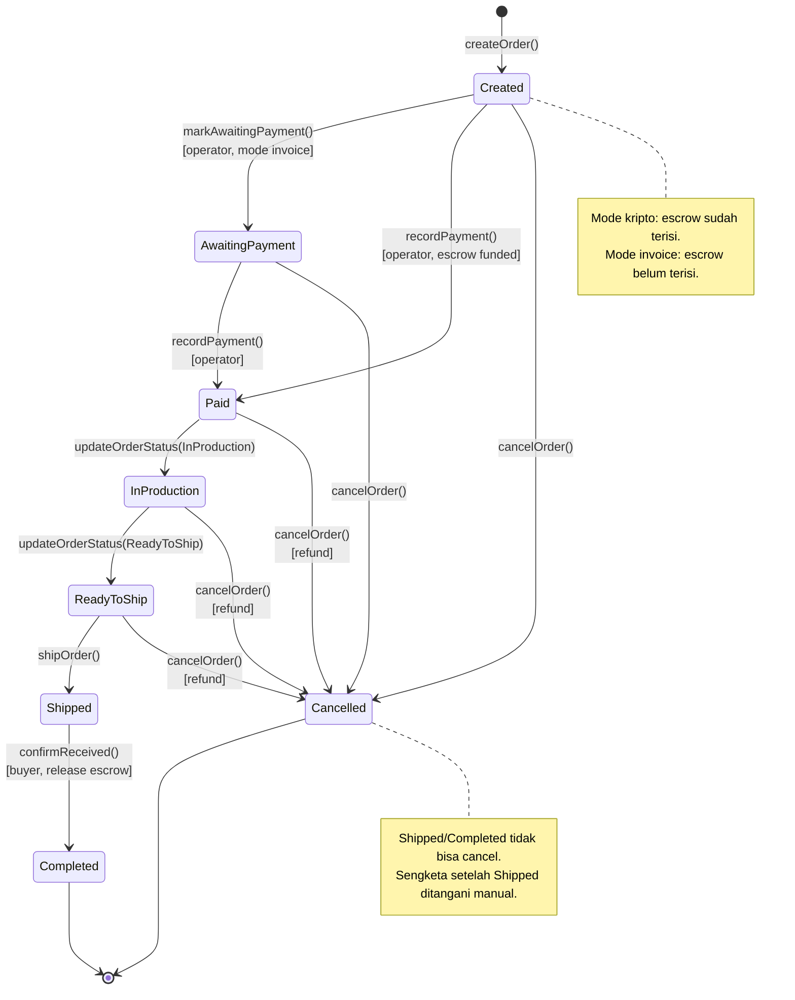
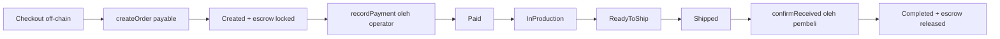
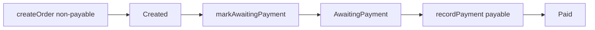

# 01 — ON/OFF-CHAIN MATRIX & STATE MACHINE

**Milestone:** Minggu 1 — Analisis & Scope Freeze
**Issue terkait:** `W1-FEE-03`, `W1-AGU-01`, `W1-YAS-04`
**Pemilik:** Muhammad Feeandri Syahbani, Agustina Elsi Bunga
**Reviewer:** Yasmin Akmaliyah, Arby Putra, Kenjiro B.H.G.
**Status:** Final v1.0
**Tanggal:** 9 November 2026

---

## 1. Prinsip Desain

1. **Data minimization:** blockchain hanya menyimpan data yang dibutuhkan untuk audit dan verifikasi finansial.
2. **Off-chain sebagai sumber data bisnis:** detail produk, alamat, file desain, dan data personal tetap di MySQL.
3. **On-chain sebagai sumber kebenaran finansial:** escrow, status order, aktor, dan event.
4. **Hash sebagai jembatan:** `externalOrderHash` mengikat order MySQL ke order on-chain tanpa membocorkan data personal.
5. **Tidak ada private key di server:** transaksi pembeli ditandatangani MetaMask. Operator memakai akun Ganache khusus melalui env lokal.
6. **State tidak boleh mundur:** semua transisi divalidasi; transisi tidak sah harus revert.

---

## 2. On/Off-Chain Matrix

| Data / Logika | On-chain | Off-chain (MySQL/PHP) | Alasan | Sumber |
|---|---|---|---|---|
| `blockchain_order_id` | ✅ | ✅ (proof) | ID order di kontrak; disalin ke DB untuk join | Minggu 1 |
| `externalOrderHash` | ✅ | ✅ | Bukti keterkaitan order MySQL tanpa data personal | Minggu 1 |
| `customerWallet` | ✅ | ✅ | Aktor transaksi dan verifikasi | Minggu 1 |
| `totalAmount` (wei) | ✅ | ✅ (rupiah + wei) | Nilai escrow dan rekonsiliasi | Minggu 1 |
| `status` order | ✅ | ✅ (mirror) | State yang diaudit; DB menyimpan mirror untuk UI | Minggu 1 |
| `paymentRecorded` | ✅ | ✅ | Bukti pembayaran sudah dicatat operator | Minggu 1 |
| `createdAt` / `updatedAt` on-chain | ✅ | ✅ | Jejak waktu immutable | Minggu 1 |
| Event (`OrderCreated`, `PaymentRecorded`, `OrderStatusUpdated`, `OrderCancelled`, `OperatorUpdated`, `OrderCompleted`, `EscrowReleased`) | ✅ | ✅ (hasil parse) | Audit trail dan verifikasi | Minggu 1 |
| `tx_hash`, `block_number`, `contract_address` | ❌ (implisit di transaksi) | ✅ | Bukti transaksi untuk UI/verifikasi | Minggu 1 |
| `verification_status` (`PENDING`/`VERIFIED`/`MISMATCH`) | ❌ | ✅ | Hasil perbandingan DB vs chain | Minggu 1 |
| Nama, email, no. telepon | ❌ | ✅ | Data personal | Minggu 1 |
| Alamat pengiriman | ❌ | ✅ | Data sensitif dan berubah | Minggu 1 |
| File/logo/desain jersey | ❌ | ✅ | File besar, tidak cocok on-chain | Minggu 1 |
| Detail item, ukuran, warna, custom text | ❌ | ✅ | Detail bisnis; bila perlu hanya hash | Minggu 1 |
| Katalog, stok, harga produk | ❌ | ✅ | Sering berubah, bukan data finansial final | Minggu 1 |
| Cart, session, user auth | ❌ | ✅ | Data sementara/rahasia | Minggu 1 |
| Metode kirim, nomor resi | ❌ | ✅ | Operasional logistik | Minggu 1 |
| Status produksi internal | ✅ (state) | ✅ (detail) | State perlu audit; detail kerja di DB | Minggu 1 |
| Queue job, checkpoint, worker log | ❌ | ✅ | Infrastruktur paralel lokal | Minggu 1 |
| Agregasi finansial (revenue, AOV, count) | ❌ | ✅ | Hasil komputasi, bukan state transaksi | Minggu 1 |
| Bukti pembayaran QRIS/fiat | ❌ | ✅ | Di luar escrow kripto | Minggu 1 |

### 2.1 Matriks aktor

| Aktor | Boleh membuat order | Boleh catat pembayaran | Boleh ubah status | Boleh cancel | Boleh konfirmasi terima |
|---|---|---|---|---|---|
| Pembeli | ✅ | ❌ | ❌ | ✅ (state terbatas) | ✅ |
| Operator | ❌ | ✅ | ✅ | ✅ (sebelum `Shipped`) | ❌ |
| Owner | ❌ | ✅ | ✅ | ✅ (sebelum `Shipped`) | ❌ |
| Admin web (off-chain) | ❌ | Memicu operator | Memicu operator | Memicu operator | ❌ |
| Pihak luar | ❌ | ❌ | ❌ | ❌ | ❌ |

> **Catatan:** admin web bukan aktor on-chain. Admin memicu transaksi yang ditandatangani akun operator melalui service/MetaMask.

---

## 3. State Machine 8 State

### 3.1 Daftar state

| # | State | Definisi | Escrow | Terminal? |
|---|---|---|---|---|
| 1 | `Created` | Order tercatat on-chain; escrow bisa sudah terisi (mode kripto) atau belum (mode invoice) | Bisa terisi | Tidak |
| 2 | `AwaitingPayment` | Operator sudah menerbitkan permintaan pembayaran; menunggu pembayaran/konfirmasi | Belum terisi | Tidak |
| 3 | `Paid` | Pembayaran dikonfirmasi operator; dana aman di escrow | Terisi | Tidak |
| 4 | `InProduction` | Pesanan masuk produksi | Terisi | Tidak |
| 5 | `ReadyToShip` | Produksi selesai, siap dikirim/diambil | Terisi | Tidak |
| 6 | `Shipped` | Barang diserahkan ke kurir / sudah dikirim | Terisi | Tidak |
| 7 | `Completed` | Pembeli konfirmasi terima; escrow dirilis ke seller | Dirilis | Ya |
| 8 | `Cancelled` | Order dibatalkan; escrow dikembalikan bila sudah terisi | Refund | Ya |

### 3.2 Diagram state

### 3.3 Alur utama (happy path kripto)

### 3.4 Alur invoice/manual (opsional)

> **Keputusan implementasi:** mode invoice hanya disiapkan di enum dan dokumentasi. Implementasi V1/V2 memprioritaskan mode kripto (escrow). Jika waktu tidak cukup, `AwaitingPayment` tetap ada di enum tetapi tidak dipakai di UI.

---

## 4. Transition Matrix

| ID | From | To | Fungsi | Aktor | Guard | Event | Revert message |
|---|---|---|---|---|---|---|---|
| T01 | — | `Created` | `createOrder(hash, amount)` | Pembeli | `amount > 0`; `msg.value == amount` (mode kripto); hash belum ada | `OrderCreated` | `Amount must be > 0`, `Incorrect amount`, `Duplicate order hash` |
| T02 | `Created` | `AwaitingPayment` | `markAwaitingPayment(id)` | Operator | order ada; belum dibayar | `OrderStatusUpdated` | `Order not found`, `Not operator`, `Invalid state transition` |
| T03 | `Created` / `AwaitingPayment` | `Paid` | `recordPayment(id)` | Operator | escrow terisi atau pembayaran valid; belum pernah dicatat | `PaymentRecorded` | `Not operator`, `Payment already recorded`, `Invalid state transition` |
| T04 | `Paid` | `InProduction` | `updateOrderStatus(id, InProduction)` | Operator | state saat ini `Paid` | `OrderStatusUpdated` | `Not operator`, `Invalid state transition` |
| T05 | `InProduction` | `ReadyToShip` | `updateOrderStatus(id, ReadyToShip)` | Operator | state saat ini `InProduction` | `OrderStatusUpdated` | `Not operator`, `Invalid state transition` |
| T06 | `ReadyToShip` | `Shipped` | `shipOrder(id)` | Operator | state saat ini `ReadyToShip` | `OrderShipped` / `OrderStatusUpdated` | `Not operator`, `Not ready to ship`, `Invalid state transition` |
| T07 | `Shipped` | `Completed` | `confirmReceived(id)` | Pembeli | `msg.sender == buyer`; escrow belum dirilis | `OrderCompleted`, `EscrowReleased` | `Not buyer`, `Not shipped yet`, `Already released` |
| T08 | `Created` | `Cancelled` | `cancelOrder(id)` | Pembeli / operator | pembeli hanya boleh di `Created`/`AwaitingPayment`; operator sebelum `Shipped` | `OrderCancelled` | `Not authorized to cancel`, `Invalid state transition` |
| T09 | `AwaitingPayment` | `Cancelled` | `cancelOrder(id)` | Pembeli / operator | sama dengan T08 | `OrderCancelled` | `Not authorized to cancel`, `Invalid state transition` |
| T10 | `Paid` | `Cancelled` | `cancelOrder(id)` | Operator / owner | belum dikirim; escrow belum dirilis; refund | `OrderCancelled`, `EscrowRefunded` | `Not authorized to cancel`, `Already released`, `Invalid state transition` |
| T11 | `InProduction` | `Cancelled` | `cancelOrder(id)` | Operator / owner | sama dengan T10 | `OrderCancelled`, `EscrowRefunded` | idem |
| T12 | `ReadyToShip` | `Cancelled` | `cancelOrder(id)` | Operator / owner | sama dengan T10 | `OrderCancelled`, `EscrowRefunded` | idem |
| T13 | `Completed` | — | — | — | terminal | — | `Order is final` |
| T14 | `Cancelled` | — | — | — | terminal | — | `Order is final` |
| T15 | `Shipped` | `Cancelled` | — | — | **tidak diizinkan**; sengketa manual | — | `Invalid state transition` |

### 4.1 Aturan cancel

| State | Pembeli | Operator | Owner | Escrow |
|---|---|---|---|---|
| `Created` | ✅ | ✅ | ✅ | Refund jika terisi |
| `AwaitingPayment` | ✅ | ✅ | ✅ | Tidak ada dana |
| `Paid` | ❌ | ✅ | ✅ | Refund |
| `InProduction` | ❌ | ✅ | ✅ | Refund |
| `ReadyToShip` | ❌ | ✅ | ✅ | Refund |
| `Shipped` | ❌ | ❌ | ❌ | Sengketa manual |
| `Completed` | ❌ | ❌ | ❌ | Selesai |
| `Cancelled` | ❌ | ❌ | ❌ | Terminal |

---

## 5. Revert Rules Matrix

| # | Kondisi | Fungsi terkait | Revert message | Test |
|---|---|---|---|---|
| R01 | `amount <= 0` | `createOrder` | `Amount must be > 0` | SC-03 |
| R02 | `msg.value != amount` | `createOrder`, `recordPayment` | `Incorrect amount` | SC-03 |
| R03 | `externalOrderHash` sudah dipakai | `createOrder` | `Duplicate order hash` | SC-04 |
| R04 | `orderId` tidak ada / 0 | semua fungsi order | `Order not found` | SC-06 |
| R05 | `msg.sender` bukan operator | fungsi operator | `Not operator` | SC-07 |
| R06 | `msg.sender` bukan pembeli | `confirmReceived` | `Not buyer` | SC-07 |
| R07 | `msg.sender` bukan owner | `addOperator`, `removeOperator` | `Not owner` | SC-07 |
| R08 | Pembayaran dicatat dua kali | `recordPayment` | `Payment already recorded` | SC-08 |
| R09 | Transisi status tidak valid | `updateOrderStatus`, `shipOrder`, `cancelOrder` | `Invalid state transition` | SC-10 |
| R10 | `confirmReceived` sebelum `Shipped` | `confirmReceived` | `Not shipped yet` | SC-12 |
| R11 | Escrow dirilis dua kali | `confirmReceived` | `Already released` | SC-12 |
| R12 | Cancel oleh aktor tidak berwenang | `cancelOrder` | `Not authorized to cancel` | SC-11 |
| R13 | Cancel order terminal (`Shipped`/`Completed`/`Cancelled`) | `cancelOrder` | `Order is final` / `Invalid state transition` | SC-11 |
| R14 | Operator alamat nol | `addOperator` | `Invalid operator` | SC-07 |
| R15 | Owner mencoba menghapus dirinya sendiri | `removeOperator` | `Cannot remove owner` | SC-07 |
| R16 | Reentrancy pada release escrow | `confirmReceived` | tidak ada reentrancy; state diubah sebelum transfer | SC-12 |

### 5.1 Urutan keamanan release escrow

1. Cek `status == Shipped`.
2. Cek `!escrow.released`.
3. Set `escrow.released = true`.
4. Set `status = Completed`.
5. Transfer ETH ke owner/seller.
6. Emit `OrderCompleted` dan `EscrowReleased`.

Urutan ini mencegah reentrancy karena state diubah sebelum transfer eksternal.

---

## 6. Pemetaan State ke Status Web Existing

| Status web (`orders.status`) | State on-chain | Catatan |
|---|---|---|
| `pending` | `Created` / `AwaitingPayment` | Order baru, belum dibayar |
| `paid` | `Paid` | Pembayaran dikonfirmasi |
| `processing` | `InProduction` | Produksi |
| `ready` | `ReadyToShip` | Siap kirim |
| `shipped` | `Shipped` | Dikirim |
| `completed` | `Completed` | Selesai |
| `cancelled` | `Cancelled` | Dibatalkan |

> **Gap:** tabel `orders` saat ini memakai enum status web yang belum tentu sama. Pemetaan ini wajib dicek di Minggu 5 saat integrasi.

---

## 7. Catatan Review Yasmin (Business Process & Acceptance)

### 7.1 Temuan

1. **Cancel setelah `Shipped` tidak diizinkan.** Ini sesuai proses bisnis normal, tetapi perlu jalur sengketa manual agar pembeli tidak tanpa perlindungan. **Rekomendasi:** dokumentasikan sebagai out-of-scope dan sediakan kontak admin.
2. **`AwaitingPayment` membingungkan** jika mode invoice tidak diimplementasikan. **Rekomendasi:** tampilkan hanya jika fitur invoice diaktifkan; UI kripto langsung `Created → Paid`.
3. **Pembeli perlu melihat status `InProduction` dan `ReadyToShip`** agar tidak bertanya-tanya. **Rekomendasi:** tambahkan label status di halaman order.
4. **Admin perlu konfirmasi sebelum cancel** karena cancel melepas escrow. **Rekomendasi:** modal konfirmasi dengan ringkasan dampak finansial.
5. **Error message harus diterjemahkan ke bahasa Indonesia di UI**, walaupun revert contract berbahasa Inggris. **Rekomendasi:** mapping error di service.

### 7.2 Pertanyaan yang harus dijawab sebelum Minggu 4

| # | Pertanyaan | Owner | Target |
|---|---|---|---|
| Q1 | Apakah `AwaitingPayment` diimplementasikan atau hanya reserved? | Agustina | Akhir Minggu 3 |
| Q2 | Siapa yang boleh cancel pada `Paid`? Operator saja atau owner juga? | Yasmin | Akhir Minggu 3 |
| Q3 | Apakah refund cancel memakai transfer langsung atau pull-pattern? | Arby/Agustina | Akhir Minggu 3 |
| Q4 | Apakah `shipOrder` tetap ada sebagai alias `updateOrderStatus(Shipped)`? | Arby | Akhir Minggu 3 |
| Q5 | Bagaimana UI menampilkan order lama yang belum punya state on-chain? | Ihsanul | Akhir Minggu 5 |

### 7.3 Kesimpulan review

State machine **disetujui dengan 5 catatan**. Tidak ada perubahan pada 8 state. Catatan Q1–Q5 menjadi input desain kontrak dan UI.

---

## 8. Catatan Review Agustina (State & Revert)

1. Transition table dianggap cukup untuk implementasi V2.
2. Revert message harus unik dan stabil karena akan diuji otomatis.
3. `cancelOrder` perlu memisahkan hak pembeli dan operator untuk menghindari one-size-fits-all modifier.
4. Event `OrderStatusUpdated` harus memuat `oldStatus` dan `newStatus` agar audit trail lengkap.
5. Perlu event `EscrowRefunded` selain `OrderCancelled` agar aliran dana terlihat jelas.

---

## 9. Tautan

- Requirement: [`00_DECISIONS_AND_SCOPE.md`](00_DECISIONS_AND_SCOPE.md)
- Business process & UAT: [`02_BUSINESS_PROCESS_AND_UAT.md`](02_BUSINESS_PROCESS_AND_UAT.md)
- Desain kontrak: [`04_CONTRACT_AND_PARALLEL_DESIGN.md`](04_CONTRACT_AND_PARALLEL_DESIGN.md)
- Test plan: [`07_TEST_PLAN.md`](07_TEST_PLAN.md)
