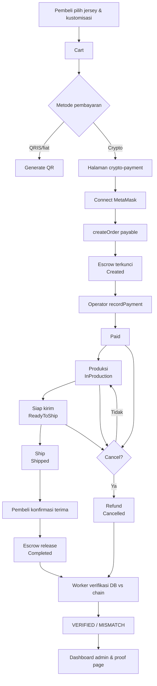
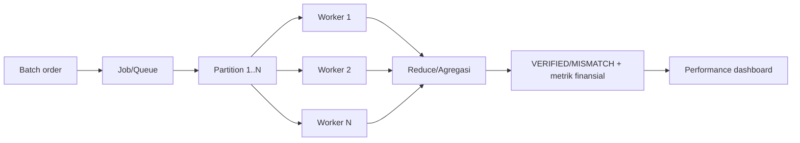
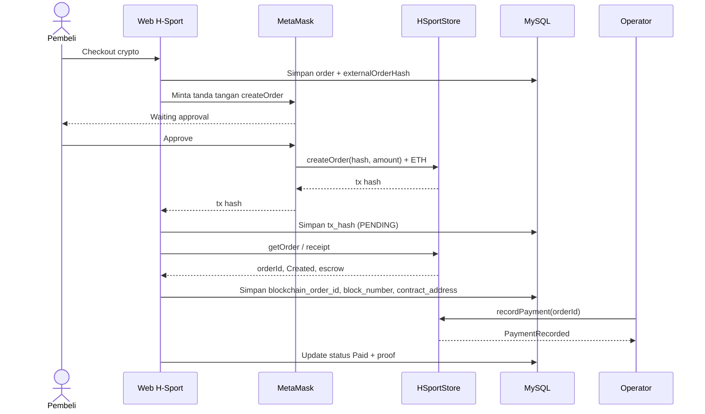
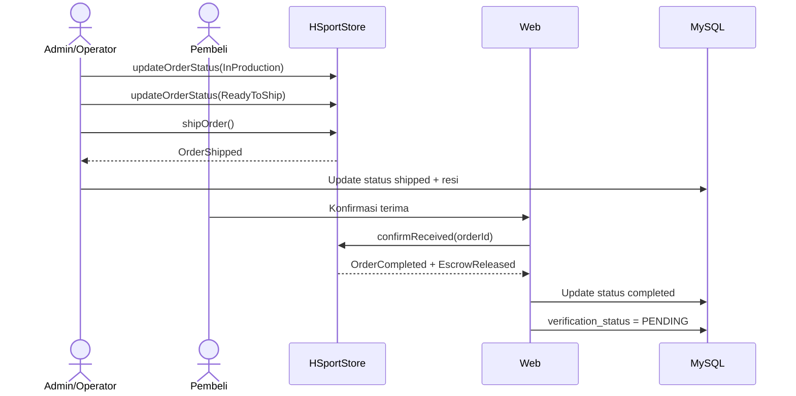
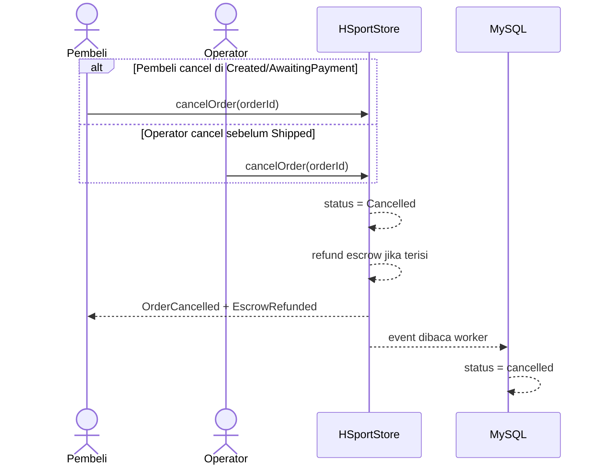
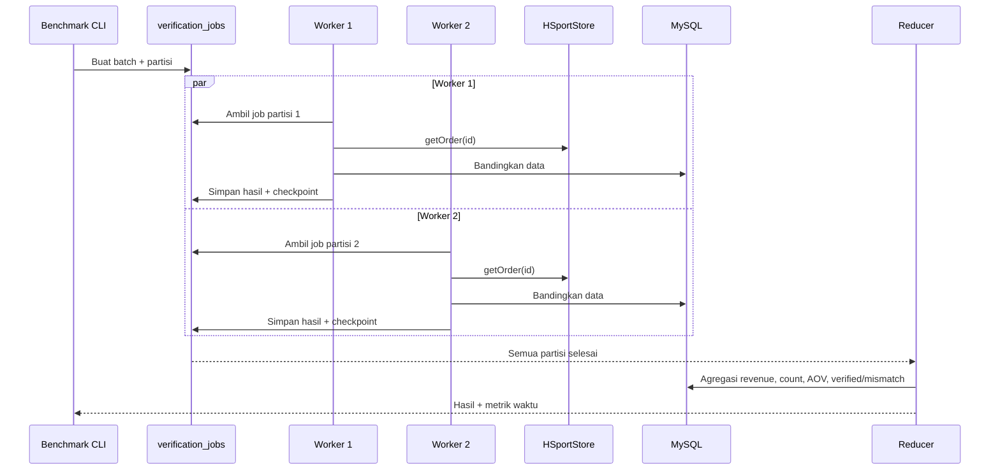

# 02 — BUSINESS PROCESS MAP, ACCEPTANCE CRITERIA & UAT

**Milestone:** Minggu 1 — Analisis & Scope Freeze
**Issue terkait:** `W1-YAS-01`, `W1-YAS-02`, `W1-YAS-03`
**Pemilik:** Yasmin Akmaliyah
**Pendukung:** Feeandri, Ihsanul, Luis
**Reviewer:** Kenjiro B.H.G.
**Status:** Final v0.1
**Tanggal:** 9 November 2026

---

## 1. Aktor & Tanggung Jawab

| Aktor | Deskripsi | Hak utama |
|---|---|---|
| **Pembeli** | Pelanggan yang memesan jersey | Checkout, bayar via MetaMask, konfirmasi terima, cancel pada state terbatas, lihat proof |
| **Operator** | Staf produksi/pengiriman | Catat pembayaran, ubah status produksi, ship, cancel sebelum shipped |
| **Owner** | Pemilik toko / deployer kontrak | Kelola operator, cancel sebelum shipped, terima escrow |
| **Admin web** | Pengguna admin H-Sport | Memicu aksi operator melalui UI/service |
| **Sistem/Worker** | PHP service + worker | Baca/tulis chain, simpan proof, verifikasi, agregasi |
| **QA** | Kenjiro | Menjalankan test, mencatat bug, validasi UAT |
| **Pihak luar** | Alamat acak | Tidak boleh melakukan aksi sensitif |

---

## 2. Business Process Map

### 2.1 Peta proses end-to-end

### 2.2 Peta proses verifikasi paralel

### 2.3 Sequence: checkout & pembayaran kripto

### 2.4 Sequence: produksi, pengiriman, konfirmasi

### 2.5 Sequence: cancel & refund

### 2.6 Sequence: verifikasi batch paralel

---

## 3. Acceptance Criteria per Milestone

| Milestone | Acceptance Criteria | Bukti |
|---|---|---|
| **M1** | 5 keputusan tertulis; scope in/out final; state diagram 8 state + cancel; traceability v0.1; workload paralel + dataset; audit integrasi/UI; 21 test punya owner; Git governance aktif; tracker akurat | Dokumen `docs/week1/*`, tracker, PR template |
| **M2** | Anggota lain dapat clone, install, compile, deploy dari README; chain ID/RPC/akun/ABI/address konsisten; test harness `truffle test` berjalan; `.env.example` ada; deployment log ada | Log deploy, screenshot, test harness |
| **M3** | Kontrak compile; 8 state + hash + mapping + modifier; `createOrder`/`getOrder`/`isOperator`; duplicate hash dan amount salah revert; SC-01 s.d. SC-06 PASS | ABI, address, test report |
| **M4** | `recordPayment`, `updateOrderStatus`, `cancelOrder`, operator management; event lengkap; invalid transition/unauthorized/double payment revert; SC-07 s.d. SC-12 PASS | Test report, tx hash |
| **M5** | Backend read/write; receipt/event parser; proof lengkap tersimpan; verification `VERIFIED`/`MISMATCH`; error handling; INT-01 s.d. INT-05 PASS | Log, screenshot, query DB |
| **M6** | Sequential baseline; Job/Queue; worker 1/2/4/8; partition/reduce; agregasi finansial; PAR-01/PAR-02 PASS | Worker log, output agregasi |
| **M7** | Dataset 100/500/1.000/5.000; benchmark 1/2/4/8 worker; speedup/efficiency/throughput; grafik; regression 21 test; bug report; UAT; dashboard performa; PAR-03/PAR-04 PASS | Tabel, grafik, test report |
| **M8** | Repo reproducible; README final; final report; traceability final; weekly log terisi; code freeze/tag; deployment guide; rehearsal; demo end-to-end | Tag, laporan, bukti demo |

---

## 4. UAT Scenario v0.1

**Aturan eksekusi:**

1. Setiap skenario dijalankan oleh minimal satu penguji selain developer.
2. Hasil dicatat: PASS/FAIL, screenshot/log/tx hash, tanggal, environment.
3. FAIL harus menghasilkan bug report dengan langkah reproduksi.
4. UAT dijalankan ulang setelah fix sebelum milestone ditutup.

| ID | Skenario | Aktor | Precondition | Langkah | Expected | Test terkait | Status |
|---|---|---|---|---|---|---|---|
| **UAT-01** | Checkout kripto happy path | Pembeli | Login, cart terisi, MetaMask terhubung ke Ganache | Checkout crypto → approve `createOrder` → tunggu receipt | Order DB dan on-chain terhubung; status `Created`; tx hash/block tersimpan | INT-02, INT-03 | Not Started |
| **UAT-02** | Amount salah ditolak | Pembeli | Contract terdeploy | Kirim `createOrder` dengan `msg.value != amount` | Transaksi revert; tidak ada order baru | SC-03 | Not Started |
| **UAT-03** | Duplicate order hash ditolak | QA | Order dengan hash tertentu sudah ada | Buat order baru dengan hash sama | Revert `Duplicate order hash` | SC-04 | Not Started |
| **UAT-04** | Operator catat pembayaran | Operator | Order `Created`, escrow terisi | Panggil `recordPayment` | Status `Paid`; event `PaymentRecorded`; DB ter-update | SC-08 | Not Started |
| **UAT-05** | Non-operator catat pembayaran | Pihak luar | Order `Created` | Panggil `recordPayment` dari akun non-operator | Revert `Not operator` | SC-07 | Not Started |
| **UAT-06** | Double payment ditolak | Operator | Order sudah `Paid` | Panggil `recordPayment` lagi | Revert `Payment already recorded` | SC-08 | Not Started |
| **UAT-07** | Transisi produksi & pengiriman | Operator | Order `Paid` | InProduction → ReadyToShip → Shipped | Setiap transisi sukses; event benar; status web mirror benar | SC-09, SC-10 | Not Started |
| **UAT-08** | Transisi tidak sah ditolak | Operator | Order `Created` | Langsung `shipOrder` | Revert `Invalid state transition` / `Not ready to ship` | SC-10 | Not Started |
| **UAT-09** | Pembeli cancel di `Created` | Pembeli | Order `Created`, escrow terisi | `cancelOrder` | Status `Cancelled`; escrow refund; event `OrderCancelled` | SC-11 | Not Started |
| **UAT-10** | Pihak luar cancel | Pihak luar | Order `Paid` | `cancelOrder` dari akun luar | Revert `Not authorized to cancel` | SC-11 | Not Started |
| **UAT-11** | Konfirmasi terima & release | Pembeli | Order `Shipped` | `confirmReceived` | Status `Completed`; saldo seller naik; event release | SC-12 | Not Started |
| **UAT-12** | Release ganda ditolak | Pembeli | Order sudah `Completed` | `confirmReceived` lagi | Revert `Already released` / `Order is final` | SC-12 | Not Started |
| **UAT-13** | Admin verifikasi DB vs chain | Admin | Order punya proof lengkap | Klik verifikasi / jalankan worker | Hasil `VERIFIED` bila cocok; `MISMATCH` bila data diubah | INT-05 | Not Started |
| **UAT-14** | Pembeli lihat proof | Pembeli | Order punya tx hash | Buka halaman proof | Tx hash, block, contract, status on-chain tampil | REQ-12 | Not Started |
| **UAT-15** | Parallel = sequential | QA | Dataset 1.000 order | Jalankan sequential lalu parallel 4 worker | Agregasi identik; waktu tercatat | PAR-01, PAR-02 | Not Started |
| **UAT-16** | Benchmark dashboard | Dosen/QA | Benchmark selesai | Buka dashboard performa | Grafik/angka speedup, efficiency, throughput tampil | PAR-03, PAR-04 | Not Started |
| **UAT-17** | Clean setup | Anggota lain | Komputer bersih | Ikuti README dari awal | Aplikasi + kontrak berjalan ≤ 30 menit | REQ-15, NFR-04 | Not Started |

---

## 5. Review Error/UX Flow

| # | Kondisi error | Penyebab | Perilaku UI yang diharapkan | Penanganan sistem | Owner |
|---|---|---|---|---|---|
| E01 | MetaMask tidak terpasang | Ekstensi tidak ada | Banner "Install MetaMask" + link | Tidak memanggil Web3 | Ihsanul |
| E02 | Wallet belum connect | User belum approve | Tombol "Connect Wallet" | Simpan state koneksi di session | Ihsanul |
| E03 | Network salah | MetaMask di jaringan lain | Peringatan + tombol "Switch to Ganache" | Cek `eth_chainId` sebelum transaksi | Luis, Ihsanul |
| E04 | User reject transaksi | User klik reject | Toast "Transaksi dibatalkan"; order tetap `Created`/`pending` | Tidak menyimpan tx hash | Ihsanul |
| E05 | Gas tidak cukup | Saldo ETH kurang | Pesan saldo kurang + saran top-up | Cek saldo sebelum submit | Luis |
| E06 | Transaksi revert | Invalid transition/unauthorized | Tampilkan alasan revert yang sudah dipetakan | Parse error contract; log | Luis, Ihsanul |
| E07 | RPC mati | Ganache berhenti | Banner "Blockchain tidak tersedia"; aksi write disabled | Health check; retry backoff | Luis, Farrel |
| E08 | Order on-chain tidak ditemukan | Ganache reset / order lama | Tampilkan "Belum ada bukti on-chain" | `getOrder` revert ditangani | Luis |
| E09 | Verification `MISMATCH` | Data DB berbeda dari chain | Badge merah + detail field yang beda | Simpan hasil verifikasi | Luis, Ihsanul |
| E10 | Pending terlalu lama | Tx belum masuk block | Status "Pending" + link tx; tombol cek ulang | Polling receipt dengan timeout | Luis, Ihsanul |
| E11 | Double submit | User klik dua kali | Tombol disabled setelah submit | Idempotency check `externalOrderHash` | Luis, Arby |
| E12 | Cancel setelah `Shipped` | Aturan state | Tombol cancel disabled + info sengketa manual | Revert contract | Yasmin, Ihsanul |

---

## 6. Requirement-to-Test Mapping (Ringkas)

| Requirement | UAT | Test otomatis |
|---|---|---|
| REQ-01 | UAT-01 | INT-02 |
| REQ-02 | UAT-01, UAT-02 | SC-02, SC-03 |
| REQ-03 | UAT-03 | SC-04 |
| REQ-04 | UAT-04, UAT-05, UAT-06 | SC-07, SC-08 |
| REQ-05 | UAT-07, UAT-08 | SC-09, SC-10 |
| REQ-06 | UAT-09, UAT-10 | SC-11 |
| REQ-07 | UAT-11, UAT-12 | SC-12 |
| REQ-08 | UAT-04, UAT-07, UAT-09, UAT-11 | SC-08, SC-09, SC-11, SC-12 |
| REQ-09 | UAT-01, UAT-04 | INT-03, INT-04 |
| REQ-10 | UAT-13 | INT-05 |
| REQ-11 | UAT-13 | INT-05 |
| REQ-12 | UAT-14 | — (manual) |
| REQ-13 | UAT-15 | PAR-01, PAR-02 |
| REQ-14 | UAT-16 | PAR-03, PAR-04 |
| REQ-15 | UAT-17 | — (manual) |

Matriks lengkap ada di [`03_TRACEABILITY_MATRIX.md`](03_TRACEABILITY_MATRIX.md).

---

## 7. Kriteria Lulus UAT

1. Semua UAT Must (UAT-01 s.d. UAT-13) PASS atau FAIL terdokumentasi dengan bug ID.
2. Tidak ada bug severity **Critical** terbuka saat demo.
3. Semua bukti tersimpan di repo atau link yang dapat diakses.
4. Hasil UAT direview Kenjiro dan Yasmin.
5. UAT dijalankan pada environment yang sama dengan demo (Ganache lokal).

---

## 8. Tautan

- Requirement: [`00_DECISIONS_AND_SCOPE.md`](00_DECISIONS_AND_SCOPE.md)
- State machine: [`01_ON_OFF_CHAIN_AND_STATE.md`](01_ON_OFF_CHAIN_AND_STATE.md)
- Traceability: [`03_TRACEABILITY_MATRIX.md`](03_TRACEABILITY_MATRIX.md)
- Test plan: [`07_TEST_PLAN.md`](07_TEST_PLAN.md)
