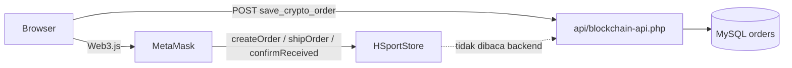
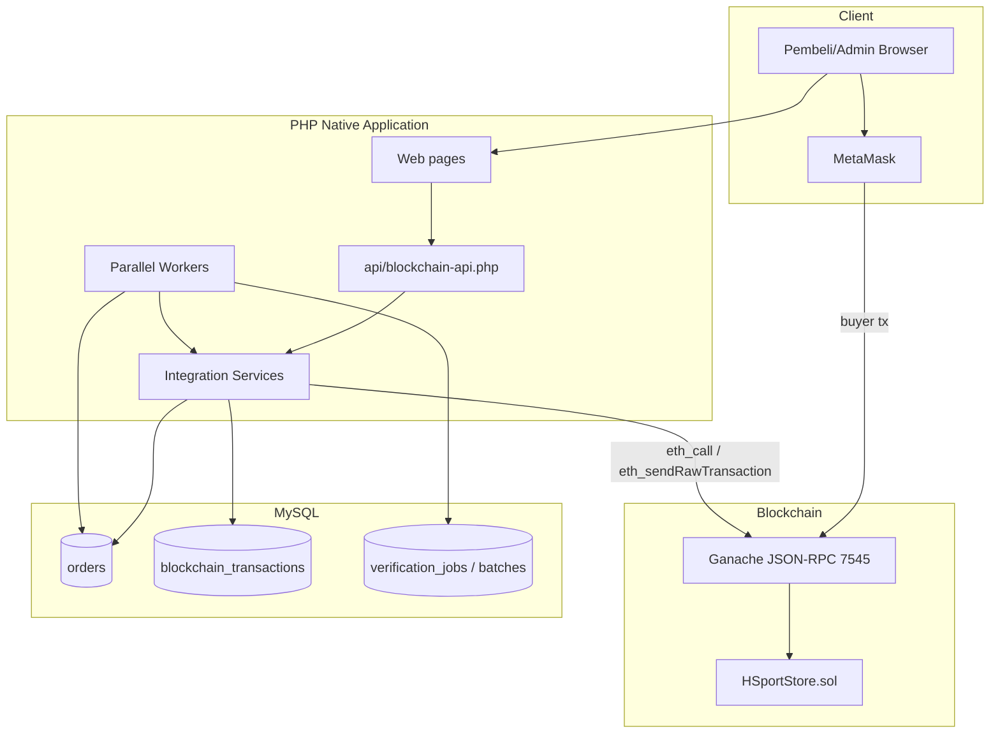
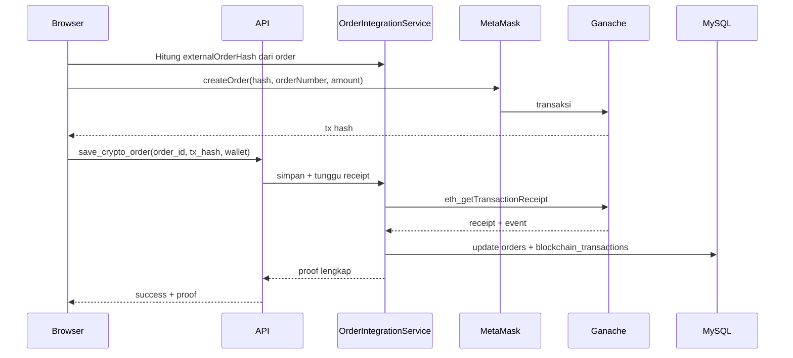
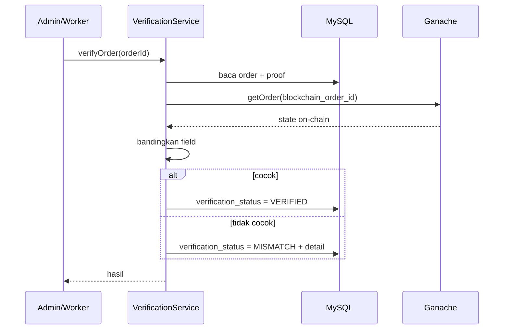

# 05 — INTEGRATION & UI DESIGN

**Milestone:** Minggu 1 — Analisis & Scope Freeze
**Issue terkait:** `W1-LUI-01`, `W1-IHS-01`
**Pemilik:** Luis (integrasi), Ihsanul Farrel (UI/UX)
**Pendukung:** Farrel, Arby, Agustina
**Reviewer:** Feeandri, Kenjiro
**Status:** Audit + desain v1.0
**Tanggal:** 9 November 2026

---

# BAGIAN A — AUDIT INTEGRASI EXISTING

## 1. Kondisi Saat Ini

| File | Mekanisme | Yang sudah ada | Gap |
|---|---|---|---|
| `crypto-payment.php` | Web3.js 4.2.2 + MetaMask, client-side | Connect wallet, cek network, tampilkan saldo, `createOrder`, modal tx, simpan `tx_hash` + `wallet_address` | Tidak menyimpan `block_number`, `contract_address`, `blockchain_order_id`, `external_order_hash`; tidak ada receipt parser; tidak ada retry; tidak ada verifikasi |
| `api/blockchain-api.php` | Endpoint JSON sederhana | Hanya aksi `save_crypto_order` | Tidak ada read, verify, health check, event parser, validasi input ketat |
| `orders.php` | Web3.js client-side | `confirmReceived` dari browser; mencari on-chain ID dengan loop `getOrderInfo` | Loop lambat/rawan gagal; tidak ada fallback; tidak ada proof display |
| `admin/orders.php` | Web3.js client-side | `shipOrder` dari browser saat status diubah ke `shipped` | Tidak ada `recordPayment`/`updateOrderStatus`; loop `getOrderInfo`; tidak ada verifikasi |
| `order-detail.php` | PHP | Menampilkan metode pembayaran | Tidak ada panel bukti blockchain |
| `admin/payments.php` | PHP | Verifikasi pembayaran manual | Tidak terhubung ke state on-chain |
| `admin/dashboard.php` | PHP | Statistik penjualan | Tidak ada metrik verifikasi/paralel |
| `admin/reports.php` | PHP | Laporan penjualan | Tidak ada benchmark/speedup |

### 1.1 Alur integrasi existing (client-side)



**Masalah utama:** backend tidak pernah membaca kontrak. Semua state on-chain hanya diketahui browser. Jika Ganache reset atau browser ditutup, bukti hilang.

---

## 2. Arsitektur Target



### 2.1 Prinsip

1. **Buyer tetap memakai MetaMask** untuk transaksi yang melibatkan dana pembeli.
2. **Backend memegang read path** sepenuhnya (receipt, event, state).
3. **Operator write** dapat melalui MetaMask admin atau service dengan private key operator dari env lokal. Private key tidak pernah masuk repo.
4. **Idempotensi** dijaga dengan `externalOrderHash` dan `tx_hash` unik.
5. **Verifikasi tidak memblokir UI**; status `PENDING` sampai worker selesai.

---

# BAGIAN B — DESAIN SERVICE INTEGRASI

## 3. Komponen Service

| Komponen | Tanggung jawab | File target |
|---|---|---|
| `BlockchainClient` | Koneksi JSON-RPC, `eth_chainId`, `eth_blockNumber`, `eth_getTransactionReceipt`, `eth_call` | `api/services/BlockchainClient.php` |
| `ContractService` | Instance kontrak, encode/decode ABI, read `getOrder`, write operator | `api/services/ContractService.php` |
| `ReceiptService` | Ambil receipt, parse log event, konfirmasi block | `api/services/ReceiptService.php` |
| `ProofRepository` | Simpan/baca proof di `orders` dan `blockchain_transactions` | `api/services/ProofRepository.php` |
| `VerificationService` | Bandingkan DB vs chain, hasil `VERIFIED`/`MISMATCH` | `api/services/VerificationService.php` |
| `OrderIntegrationService` | Orkestrasi create/sync/verify | `api/services/OrderIntegrationService.php` |
| `WorkerRunner` | Klaim job, proses partisi, checkpoint | `worker/run.php` |
| `Reducer` | Agregasi hasil partisi | `worker/reduce.php` |

### 3.1 Interface method (PHP)

```php
interface BlockchainClientInterface {
    public function chainId(): int;
    public function blockNumber(): int;
    public function call(string $to, string $data): string;
    public function getReceipt(string $txHash): ?array;
}

interface ContractServiceInterface {
    public function getOrder(int $blockchainOrderId): array;
    public function getOrderIdByHash(string $externalOrderHash): int;
    public function isOperator(string $address): bool;
    public function recordPayment(int $blockchainOrderId, string $operatorKey): string; // tx hash
    public function updateOrderStatus(int $blockchainOrderId, int $newStatus, string $operatorKey): string;
    public function shipOrder(int $blockchainOrderId, string $operatorKey): string;
}

interface VerificationServiceInterface {
    public function verifyOrder(int $orderId): array; // status, fields, checked_at
    public function verifyBatch(int $batchId): array;
}
```

### 3.2 Alur create order



### 3.3 Alur verifikasi



---

## 4. API Contract

Endpoint tetap `api/blockchain-api.php`, tetapi diperluas dengan `action`.

### 4.1 `health`

**Request**

```json
{ "action": "health" }
```

**Response**

```json
{
  "success": true,
  "chain_id": 1337,
  "block_number": 123,
  "contract_address": "0x...",
  "rpc_ok": true
}
```

### 4.2 `save_crypto_order`

**Request**

```json
{
  "action": "save_crypto_order",
  "order_id": 42,
  "tx_hash": "0x...",
  "wallet_address": "0x...",
  "blockchain_order_id": 7,
  "external_order_hash": "0x..."
}
```

**Response**

```json
{
  "success": true,
  "verification_status": "PENDING",
  "block_number": 123,
  "contract_address": "0x..."
}
```

**Aturan:** `tx_hash` unik; `order_id` harus ada; `wallet_address` harus sama dengan buyer on-chain; jika receipt belum tersedia, simpan `PENDING` dan kembalikan `receipt_pending: true`.

### 4.3 `get_order_proof`

**Request**

```json
{ "action": "get_order_proof", "order_id": 42 }
```

**Response**

```json
{
  "success": true,
  "order_id": 42,
  "tx_hash": "0x...",
  "block_number": 123,
  "contract_address": "0x...",
  "wallet_address": "0x...",
  "blockchain_order_id": 7,
  "external_order_hash": "0x...",
  "on_chain_status": "Paid",
  "verification_status": "VERIFIED",
  "verified_at": "2026-11-09 10:00:00",
  "events": [
    { "event": "OrderCreated", "block": 123, "tx_hash": "0x..." }
  ]
}
```

### 4.4 `verify_order`

**Request**

```json
{ "action": "verify_order", "order_id": 42, "force": false }
```

**Response**

```json
{
  "success": true,
  "verification_status": "VERIFIED",
  "differences": [],
  "checked_at": "2026-11-09 10:00:00"
}
```

Jika mismatch:

```json
{
  "success": true,
  "verification_status": "MISMATCH",
  "differences": [
    { "field": "total_amount", "db": "250000", "chain": "260000" }
  ]
}
```

### 4.5 `sync_order`

**Request**

```json
{ "action": "sync_order", "order_id": 42 }
```

**Response**

```json
{
  "success": true,
  "on_chain_status": "Shipped",
  "db_status": "shipped",
  "updated": true
}
```

### 4.6 Kode error API

| Kode | HTTP | Arti |
|---|---|---|
| `INVALID_ACTION` | 400 | Action tidak dikenal |
| `INVALID_INPUT` | 400 | Field wajib kosong/format salah |
| `ORDER_NOT_FOUND` | 404 | Order DB tidak ada |
| `CHAIN_ORDER_NOT_FOUND` | 404 | Order on-chain tidak ada |
| `DUPLICATE_TX` | 409 | Tx hash sudah dipakai order lain |
| `RPC_UNAVAILABLE` | 503 | Ganache tidak merespons |
| `WRONG_NETWORK` | 409 | Chain ID tidak sesuai |
| `CONTRACT_REVERT` | 422 | Transaksi revert |
| `RECEIPT_PENDING` | 202 | Receipt belum tersedia |

---

## 5. Persistensi Proof

| Field | Tabel | Sumber | Wajib |
|---|---|---|---|
| `tx_hash` | `orders`, `blockchain_transactions` | MetaMask/service | ✅ |
| `block_number` | `orders`, `blockchain_transactions` | Receipt | ✅ |
| `contract_address` | `orders`, `blockchain_transactions` | Config deploy | ✅ |
| `wallet_address` | `orders`, `blockchain_transactions` | MetaMask | ✅ |
| `blockchain_order_id` | `orders`, `blockchain_transactions` | Event `OrderCreated` / `orderCount` | ✅ |
| `external_order_hash` | `orders`, `blockchain_transactions` | Perhitungan order | ✅ |
| `verification_status` | `orders`, `blockchain_transactions` | Verification service | ✅ |
| `event_name` | `blockchain_transactions` | Receipt log | ✅ |
| `payload` | `blockchain_transactions` | Receipt/log mentah | ✅ |

### 5.1 Rumus `externalOrderHash`

```text
externalOrderHash = keccak256(
    order_number || "|" ||
    user_id || "|" ||
    total_amount || "|" ||
    created_at
)
```

Aturan:

1. Nilai dinormalisasi (trim, lowercase untuk string.
2. `created_at` memakai format `Y-m-d H:i:s`.
3. Hash dihitung sekali saat checkout dan disimpan di DB.
4. Hash yang sama tidak boleh dipakai dua kali.
5. Detail rumus final disepakati Luis + Arby di Minggu 3 dan diuji SC-04/INT-02.

---

## 6. Error Handling & Retry

| Kondisi | Deteksi | Aksi | Retry |
|---|---|---|---|
| RPC mati | `health` gagal / cURL error | Tampilkan banner; tunda write | Backoff 2s, 4s, 8s (maks 3) |
| Wrong network | `eth_chainId` ≠ config | Minta switch network | Manual |
| User reject | Error code 4001 | Batalkan; order tetap `pending` | Manual |
| Receipt pending | `eth_getTransactionReceipt` null | Status `PENDING`; poll 3s | Maks 60 detik |
| Receipt timeout | 60 detik | Tandai `PENDING` + minta cek manual | Manual |
| Contract revert | `eth_call`/receipt status 0 | Parse reason; tampilkan | Tidak |
| Order not found | `getOrder` revert | `MISMATCH`/`ERROR` + log | Tidak |
| Duplicate tx | `tx_hash` sudah ada | Tolak; tampilkan order terkait | Tidak |
| Double submit | `externalOrderHash` sudah ada | Tolak di kontrak/API | Tidak |

---

## 7. Keamanan

1. **Private key:** hanya operator key di `.env` lokal; tidak pernah di repo; `.env` masuk `.gitignore`.
2. **Buyer key:** tetap di MetaMask; backend tidak meminta private key.
3. **Input validation:** `order_id` integer, `tx_hash` regex `^0x[a-fA-F0-9]{64}$`, `wallet_address` regex `^0x[a-fA-F0-9]{40}$`, hash `^0x[a-fA-F0-9]{64}$`.
4. **Authorization:** endpoint verifikasi hanya untuk admin yang login; proof page hanya untuk pemilik order atau admin.
5. **CSRF:** form admin memakai token yang sudah ada.
6. **SQL injection:** semua query prepared statement.
7. **Log:** jangan log private key, token, atau data personal.
8. **Replay:** `tx_hash` unik; `externalOrderHash` unik.
9. **Rate limit:** health/verify maksimal 10 request/menit per sesi.

---

# BAGIAN C — AUDIT & DESAIN UI

## 8. Gap UI

| Komponen | Existing | Gap | Target |
|---|---|---|---|
| Wallet connect | Ada di `crypto-payment.php` | Belum reusable di halaman lain | Komponen `includes/wallet-widget.php` |
| Network guard | Ada di `crypto-payment.php` | Belum konsisten | Cek `chainId` sebelum semua aksi |
| Tx status | Modal di `crypto-payment.php` | Belum ada status `failed/revert` terstruktur | Komponen `tx-status` dengan 7 state |
| Proof page | Tidak ada | Tidak ada halaman publik | `order-proof.php` |
| Verification dashboard | Tidak ada | Admin tidak bisa lihat `VERIFIED`/`MISMATCH` | `admin/verification.php` |
| Performance dashboard | Tidak ada | Tidak ada grafik speedup | `admin/performance.php` |
| Order detail proof | Tidak ada | Pembeli tidak lihat tx hash di detail | Panel proof di `order-detail.php` |
| Error UX | Sebagian | Pesan error teknis, belum diterjemahkan | Mapping error ID → pesan Indonesia |
| Loading/empty state | Sebagian | Belum konsisten | Skeleton + empty state |

---

## 9. Desain Halaman & Komponen

### 9.1 Wallet widget

**File:** `includes/wallet-widget.php`, `assets/js/web3-wallet.js`

**State:**

| State | Tampilan | Aksi |
|---|---|---|
| `disconnected` | "Connect Wallet" | Buka MetaMask |
| `connecting` | Spinner | — |
| `wrong-network` | Peringatan + "Switch to Ganache" | `wallet_switchEthereumChain` |
| `connected` | Alamat terpotong + saldo ETH | Ganti akun / disconnect |
| `no-metamask` | Banner install | Link MetaMask |

### 9.2 Transaction status

**File:** `assets/js/tx-status.js`

| State | Ikon | Pesan | Tombol |
|---|---|---|---|
| `idle` | — | — | — |
| `awaiting-approval` | 🦊 | "Konfirmasi di MetaMask" | — |
| `pending` | ⏳ | "Menunggu konfirmasi block" | Lihat tx |
| `confirmed` | ✅ | "Transaksi berhasil" | Lihat proof |
| `failed` | ❌ | "Transaksi gagal" | Coba lagi |
| `reverted` | ⚠️ | Alasan revert yang dipetakan | Tutup |
| `timeout` | ⏱️ | "Belum terkonfirmasi" | Cek ulang |

### 9.3 Blockchain proof page

**File:** `order-proof.php?order_id=...`

**Isi:**

1. Ringkasan order: nomor, tanggal, total, status.
2. Kartu bukti: tx hash (copy), block number, contract address, wallet, blockchain order ID, external order hash.
3. Status on-chain vs off-chain + badge `VERIFIED`/`MISMATCH`/`PENDING`.
4. Timeline event: `OrderCreated` → `PaymentRecorded` → `OrderStatusUpdated` → `OrderCompleted`.
5. Link ke Ganache/block explorer lokal (jika tersedia).
6. Peringatan jika order belum punya bukti on-chain.

**Akses:** pembeli pemilik order atau admin. Order lain → 403.

### 9.4 Verification dashboard

**File:** `admin/verification.php`

**Kolom tabel:** order number, buyer, total, status DB, status chain, verification status, last checked, aksi (verify/retry/detail).

**Fitur:**

- Filter `VERIFIED`/`MISMATCH`/`PENDING`.
- Tombol "Verify" per order dan "Verify batch".
- Detail perbedaan field untuk `MISMATCH`.
- Ringkasan count.

### 9.5 Performance dashboard

**File:** `admin/performance.php`

**Isi:**

1. Tabel batch: dataset, worker, mode, duration, throughput, speedup, efficiency, correctness gate.
2. Grafik execution time vs worker count.
3. Grafik speedup vs worker count (dengan garis ideal).
4. Grafik throughput.
5. Status correctness: `MATCH`/`DIFFERENT`.
6. Filter dataset dan mode.

**Sumber data:** view `v_benchmark_summary`.

---

## 10. Matriks Status UI

| Kondisi | Badge | Warna | Aksi tersedia |
|---|---|---|---|
| Order belum on-chain | `OFF-CHAIN` | Abu-abu | Bayar |
| Tx pending | `PENDING` | Kuning | Lihat tx |
| Tx confirmed | `ON-CHAIN` | Biru | Lihat proof |
| Verifikasi cocok | `VERIFIED` | Hijau | — |
| Verifikasi beda | `MISMATCH` | Merah | Detail, retry |
| RPC mati | `RPC OFFLINE` | Merah | Retry |
| Network salah | `WRONG NETWORK` | Oranye | Switch |
| Order final | `COMPLETED`/`CANCELLED` | Hijau/Abu-abu | Lihat proof |

---

## 11. Definition of Done Integrasi & UI

### Integrasi

- [ ] Backend bisa `health`, `getOrder`, `getReceipt`, `verifyOrder`.
- [ ] `save_crypto_order` menyimpan 6 field proof.
- [ ] `tx_hash` unik dan tervalidasi.
- [ ] Verification menghasilkan `VERIFIED`/`MISMATCH` dengan detail.
- [ ] Error RPC/revert/not-found ditangani.
- [ ] INT-01 s.d. INT-05 PASS.

### UI

- [ ] Wallet widget reusable dan mendeteksi network.
- [ ] Tx status membedakan 7 state.
- [ ] Proof page menampilkan semua field proof.
- [ ] Verification dashboard menampilkan status dan retry.
- [ ] Performance dashboard menampilkan grafik benchmark.
- [ ] Error message berbahasa Indonesia.
- [ ] UAT-14 dan UAT-16 PASS.

---

## 12. Tautan

- State machine: [`01_ON_OFF_CHAIN_AND_STATE.md`](01_ON_OFF_CHAIN_AND_STATE.md)
- Skema DB: [`../../migration_blockchain.sql`](../../migration_blockchain.sql)
- Desain paralel: [`04_CONTRACT_AND_PARALLEL_DESIGN.md`](04_CONTRACT_AND_PARALLEL_DESIGN.md)
- Test plan: [`07_TEST_PLAN.md`](07_TEST_PLAN.md)
